# MALA → CP2K: pristine systems, reference controls and boron vacancies

*Markdown text extraction of `MALA_CP2K_benchmark.pdf` (103 pages).*

> Slide text is included below in page order, followed by a rendered image of each original slide (including its plots). Speaker notes are not included in the PDF text extraction.

## 001 · Can a learned density accelerate CP2K SCF?

*MALA → CP2K*

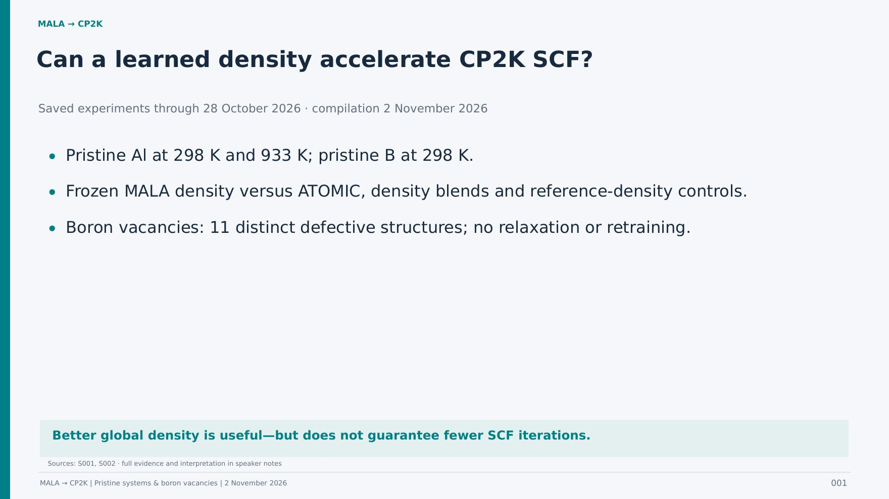

Saved experiments through 28 October 2026 · compilation 2 November 2026  
- Pristine Al at 298 K and 933 K; pristine B at 298 K.
- Frozen MALA density versus ATOMIC, density blends and reference-density controls.
- Boron vacancies: 11 distinct defective structures; no relaxation or retraining.
Better global density is useful—but does not guarantee fewer SCF iterations.  
Sources: S001, S002 · full evidence and interpretation in speaker notes  

## 002 · The main observations

*RESULTS AT A GLANCE*

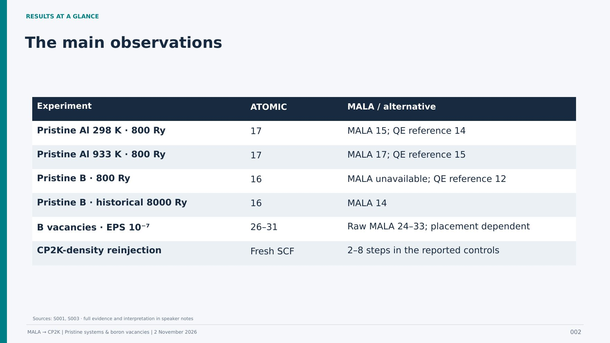

Experiment                                                               ATOMIC      MALA / alternative  
Pristine Al 298 K · 800 Ry                                               17          MALA 15; QE reference 14  
Pristine Al 933 K · 800 Ry                                               17          MALA 17; QE reference 15  
Pristine B · 800 Ry                                                      16          MALA unavailable; QE reference 12  
Pristine B · historical 8000 Ry                                          16          MALA 14  
B vacancies · EPS 10⁻⁷                                                   26–31       Raw MALA 24–33; placement dependent  
CP2K-density reinjection                                                 Fresh SCF   2–8 steps in the reported controls  
Sources: S001, S003 · full evidence and interpretation in speaker notes  

## 003 · The inference pipeline changes the initial density

*WORKFLOW*

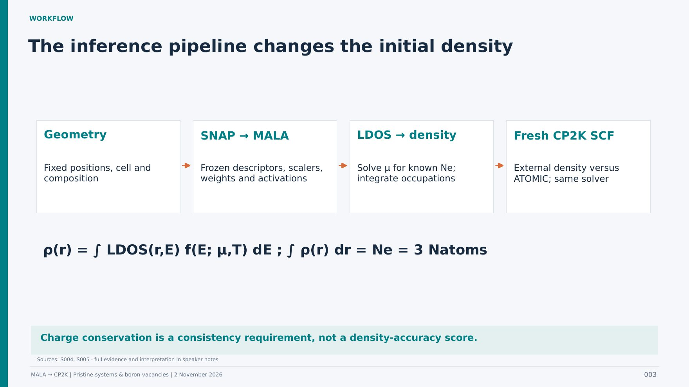

Geometry                                                      SNAP → MALA                    LDOS → density          Fresh CP2K SCF  
| Fixed positions, cell and | Frozen descriptors, scalers, | Solve μ for known Ne; | External density versus |
| --- | --- | --- | --- |
| composition | weights and activations | integrate occupations | ATOMIC; same solver |

ρ(r) = ∫ LDOS(r,E) f(E; μ,T) dE ; ∫ ρ(r) dr = Ne = 3 Natoms  
Charge conservation is a consistency requirement, not a density-accuracy score.  
Sources: S004, S005 · full evidence and interpretation in speaker notes  

## 004 · Snapshots and checkpoints remain explicit

*PROVENANCE*

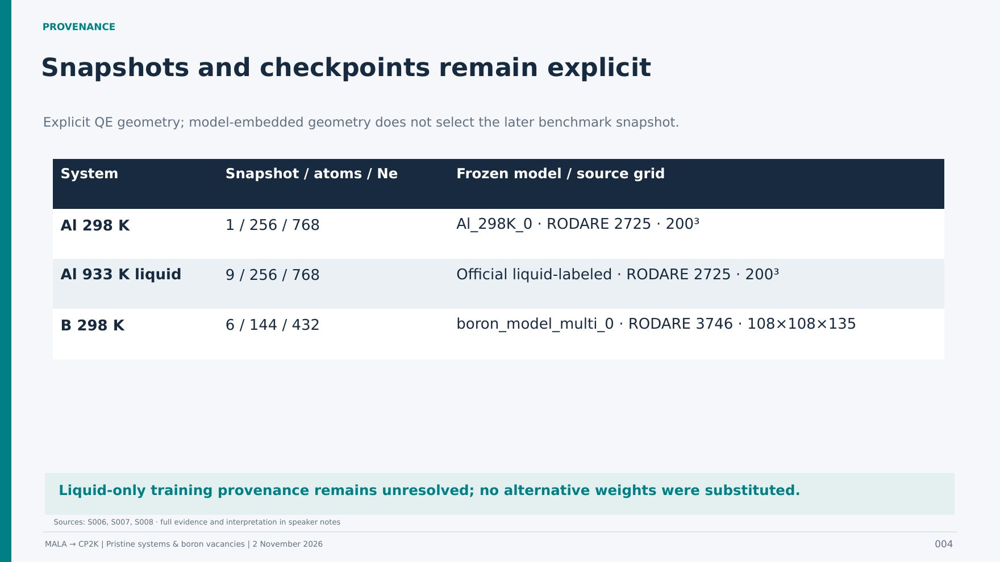

Explicit QE geometry; model-embedded geometry does not select the later benchmark snapshot.  
System                                       Snapshot / atoms / Ne             Frozen model / source grid  
Al 298 K                                     1 / 256 / 768                     Al_298K_0 · RODARE 2725 · 200³  
Al 933 K liquid                              9 / 256 / 768                     Official liquid-labeled · RODARE 2725 · 200³  
B 298 K                                      6 / 144 / 432                     boron_model_multi_0 · RODARE 3746 · 108×108×135  
Liquid-only training provenance remains unresolved; no alternative weights were substituted.  
Sources: S006, S007, S008 · full evidence and interpretation in speaker notes  

## 005 · CP2K settings and actual grid sizes

*FROZEN SETUP*

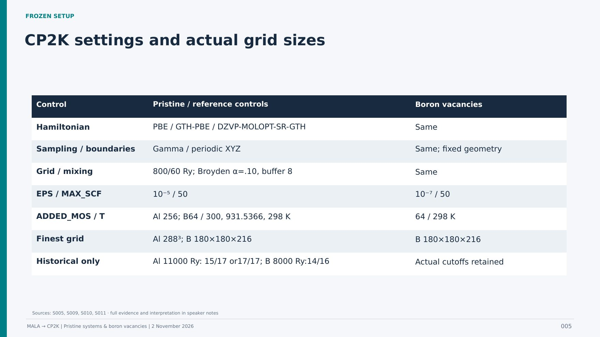

Control                                             Pristine / reference controls                 Boron vacancies  
Hamiltonian                                         PBE / GTH-PBE / DZVP-MOLOPT-SR-GTH            Same  
Sampling / boundaries                               Gamma / periodic XYZ                          Same; fixed geometry  
Grid / mixing                                       800/60 Ry; Broyden α=.10, buffer 8            Same  
EPS / MAX_SCF                                       10⁻⁵ / 50                                     10⁻⁷ / 50  
ADDED_MOS / T                                       Al 256; B64 / 300, 931.5366, 298 K            64 / 298 K  
Finest grid                                         Al 288³; B 180×180×216                        B 180×180×216  
Historical only                                     Al 11000 Ry: 15/17 or17/17; B 8000 Ry:14/16   Actual cutoffs retained  
Sources: S005, S009, S010, S011 · full evidence and interpretation in speaker notes  

## 006 · What each comparison measures

*COMPARISON RULES*

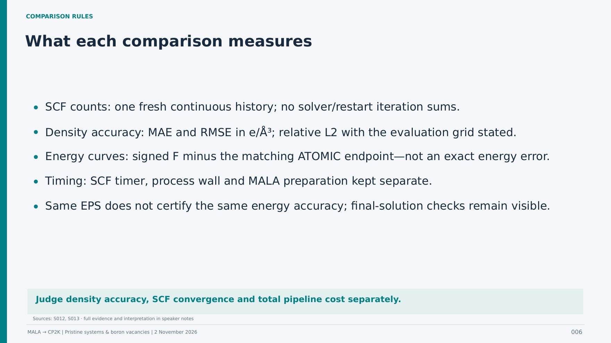

- SCF counts: one fresh continuous history; no solver/restart iteration sums.
- Density accuracy: MAE and RMSE in e/ų; relative L2 with the evaluation grid stated.
- Energy curves: signed F minus the matching ATOMIC endpoint—not an exact energy error.
- Timing: SCF timer, process wall and MALA preparation kept separate.
- Same EPS does not certify the same energy accuracy; final-solution checks remain visible.
Judge density accuracy, SCF convergence and total pipeline cost separately.  
Sources: S012, S013 · full evidence and interpretation in speaker notes  

## 007 · Al 298 K · MALA saves two Broyden steps

*PRISTINE*

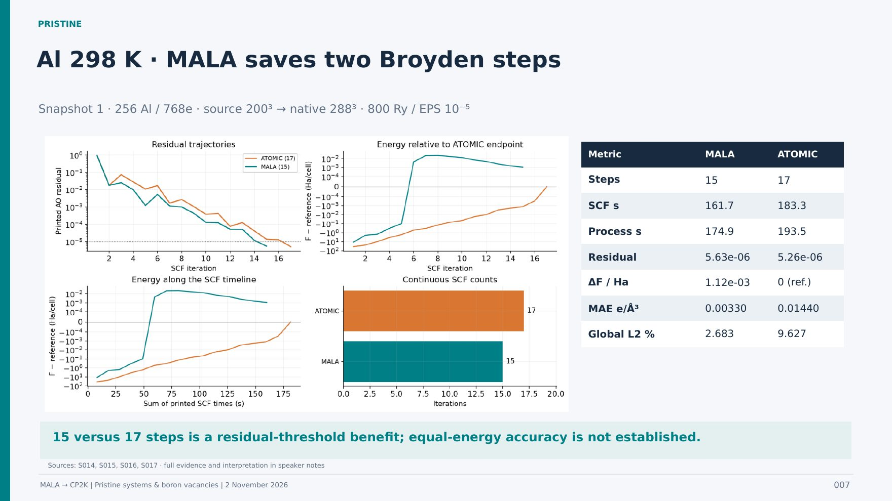

Snapshot 1 · 256 Al / 768e · source 200³ → native 288³ · 800 Ry / EPS 10⁻⁵  
Metric        MALA       ATOMIC  
Steps         15         17  
SCF s         161.7      183.3  
Process s     174.9      193.5  
Residual      5.63e-06   5.26e-06  
ΔF / Ha       1.12e-03   0 (ref.)  
MAE e/ų      0.00330    0.01440  
Global L2 %   2.683      9.627  
15 versus 17 steps is a residual-threshold benefit; equal-energy accuracy is not established.  
Sources: S014, S015, S016, S017 · full evidence and interpretation in speaker notes  

## 008 · Al 298 K · the Fourier structure matters

*DENSITY & FOURIER*

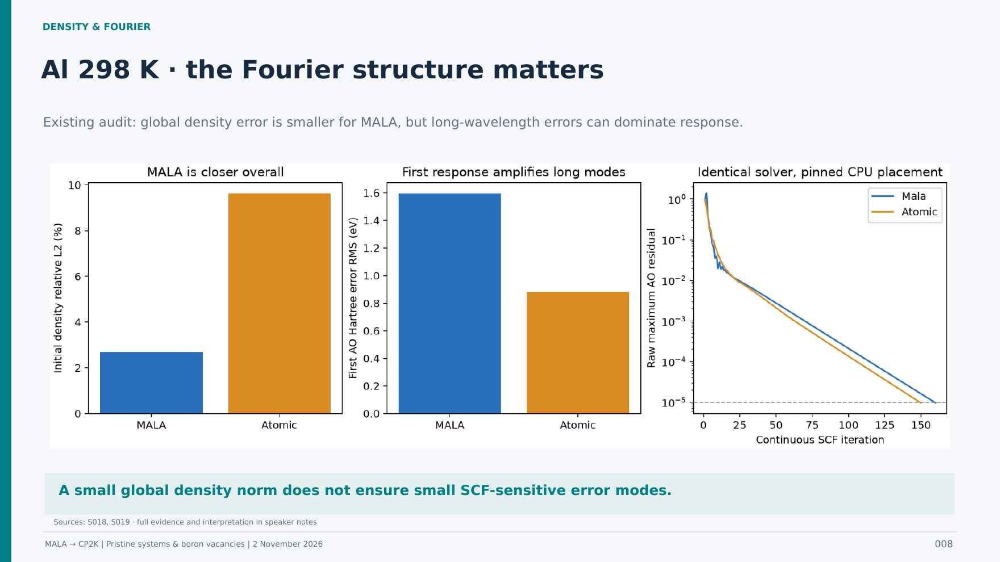

Existing audit: global density error is smaller for MALA, but long-wavelength errors can dominate response.  
A small global density norm does not ensure small SCF-sensitive error modes.  
Sources: S018, S019 · full evidence and interpretation in speaker notes  

## 009 · Al 298 K · scalar constraints and a 90/10 blend

*POSTPROCESSING*

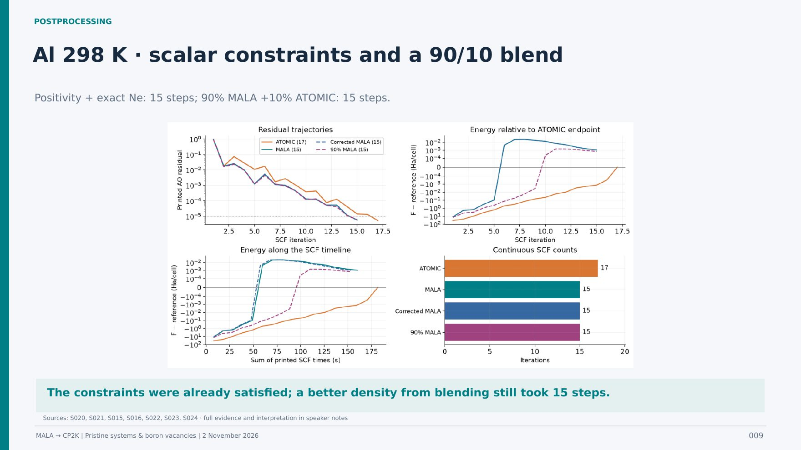

Positivity + exact Ne: 15 steps; 90% MALA +10% ATOMIC: 15 steps.  
The constraints were already satisfied; a better density from blending still took 15 steps.  
Sources: S020, S021, S015, S016, S022, S023, S024 · full evidence and interpretation in speaker notes  

## 010 · Al 933 K · no observed MALA acceleration

*PRISTINE*

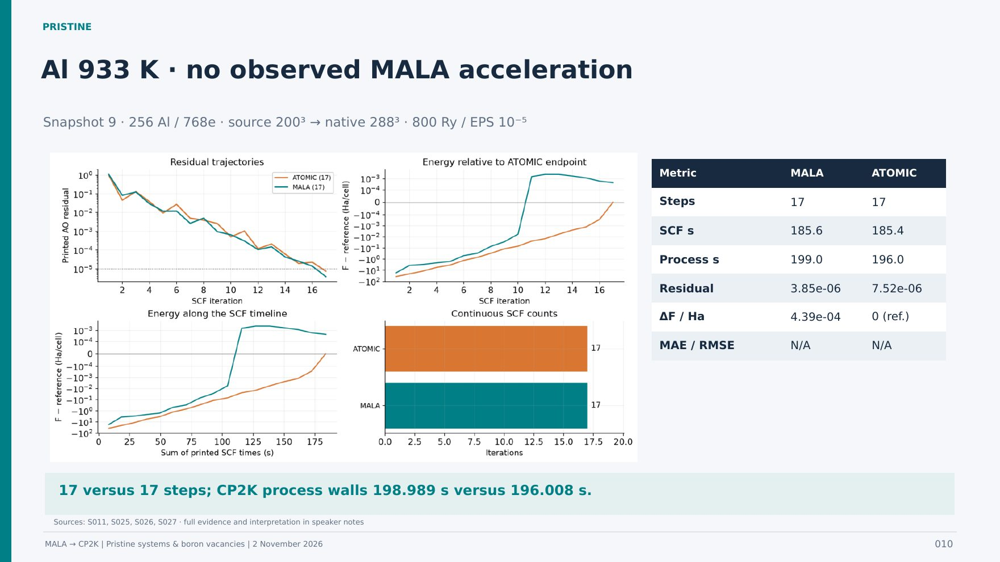

Snapshot 9 · 256 Al / 768e · source 200³ → native 288³ · 800 Ry / EPS 10⁻⁵  
Metric       MALA       ATOMIC  
Steps        17         17  
SCF s        185.6      185.4  
Process s    199.0      196.0  
Residual     3.85e-06   7.52e-06  
ΔF / Ha      4.39e-04   0 (ref.)  
MAE / RMSE   N/A        N/A  
17 versus 17 steps; CP2K process walls 198.989 s versus 196.008 s.  
Sources: S011, S025, S026, S027 · full evidence and interpretation in speaker notes  

## 011 · Al 933 K · all four blends still require 17 steps

*POSTPROCESSING*

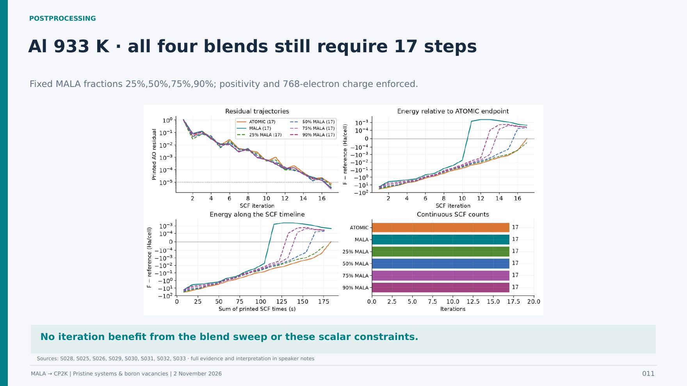

Fixed MALA fractions 25%,50%,75%,90%; positivity and 768-electron charge enforced.  
No iteration benefit from the blend sweep or these scalar constraints.  
Sources: S028, S025, S026, S029, S030, S031, S032, S033 · full evidence and interpretation in speaker notes  

## 012 · B 298 K · retain the actual 8000-Ry baseline

*PRISTINE*

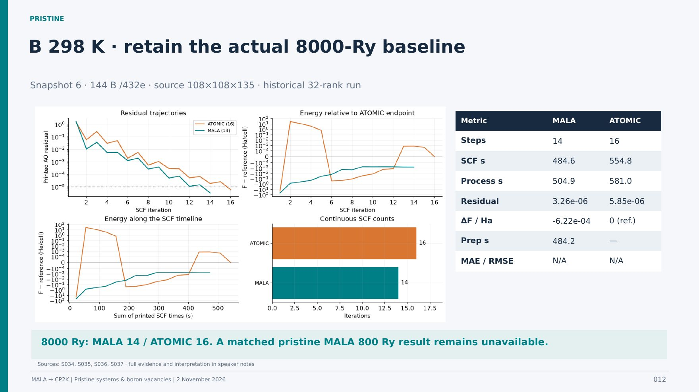

Snapshot 6 · 144 B /432e · source 108×108×135 · historical 32-rank run  
Metric       MALA        ATOMIC  
Steps        14          16  
SCF s        484.6       554.8  
Process s    504.9       581.0  
Residual     3.26e-06    5.85e-06  
ΔF / Ha      -6.22e-04   0 (ref.)  
Prep s       484.2       —  
MAE / RMSE   N/A         N/A  
8000 Ry: MALA 14 / ATOMIC 16. A matched pristine MALA 800 Ry result remains unavailable.  
Sources: S034, S035, S036, S037 · full evidence and interpretation in speaker notes  

## 013 · SCF savings and pipeline cost are different questions

*TIME ACCOUNTING*

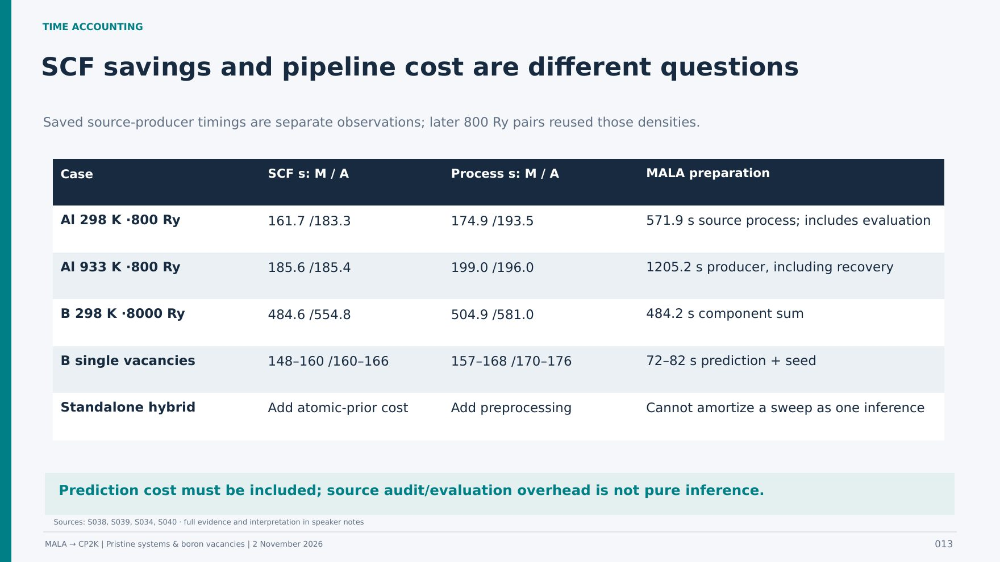

Saved source-producer timings are separate observations; later 800 Ry pairs reused those densities.  
Case                                                    SCF s: M / A                 Process s: M / A    MALA preparation  
Al 298 K ·800 Ry                                        161.7 /183.3                 174.9 /193.5        571.9 s source process; includes evaluation  
Al 933 K ·800 Ry                                        185.6 /185.4                 199.0 /196.0        1205.2 s producer, including recovery  
B 298 K ·8000 Ry                                        484.6 /554.8                 504.9 /581.0        484.2 s component sum  
B single vacancies                                      148–160 /160–166             157–168 /170–176    72–82 s prediction + seed  
Standalone hybrid                                       Add atomic-prior cost        Add preprocessing   Cannot amortize a sweep as one inference  
Prediction cost must be included; source audit/evaluation overhead is not pure inference.  
Sources: S038, S039, S034, S040 · full evidence and interpretation in speaker notes  

## 014 · Al 298 K · CP2K-converged density reinjection

*CONTROLS*

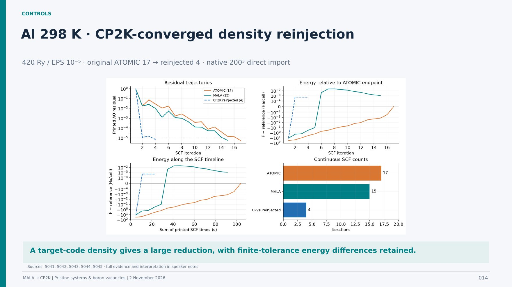

420 Ry / EPS 10⁻⁵ · original ATOMIC 17 → reinjected 4 · native 200³ direct import  
A target-code density gives a large reduction, with finite-tolerance energy differences retained.  
Sources: S041, S042, S043, S044, S045 · full evidence and interpretation in speaker notes  

## 015 · Al 933 K · CP2K-converged density reinjection

*CONTROLS*

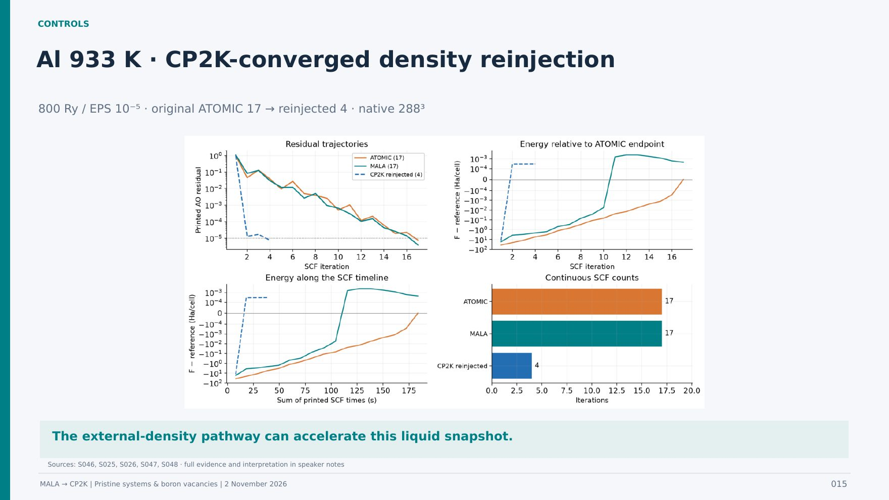

800 Ry / EPS 10⁻⁵ · original ATOMIC 17 → reinjected 4 · native 288³  
The external-density pathway can accelerate this liquid snapshot.  
Sources: S046, S025, S026, S047, S048 · full evidence and interpretation in speaker notes  

## 016 · B 298 K · CP2K-converged density reinjection

*CONTROLS*

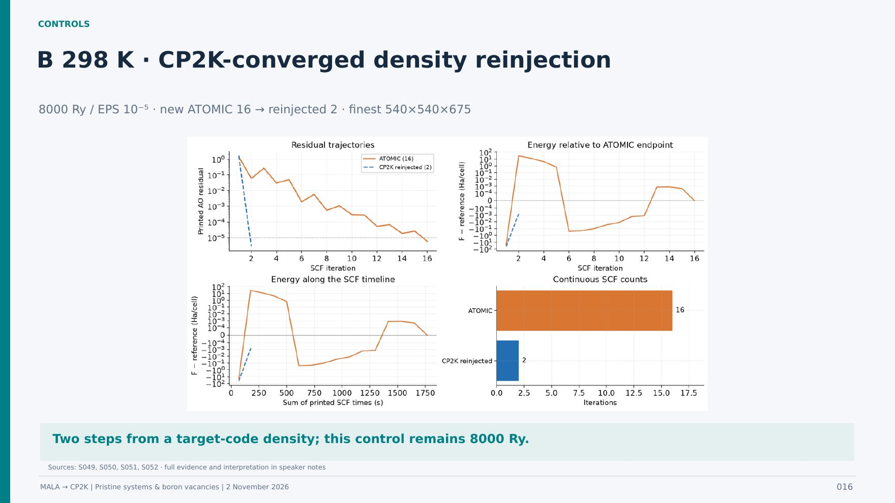

8000 Ry / EPS 10⁻⁵ · new ATOMIC 16 → reinjected 2 · finest 540×540×675  
Two steps from a target-code density; this control remains 8000 Ry.  
Sources: S049, S050, S051, S052 · full evidence and interpretation in speaker notes  

## 017 · How the QE-reference densities were verified

*QE REFERENCE CONTROLS*

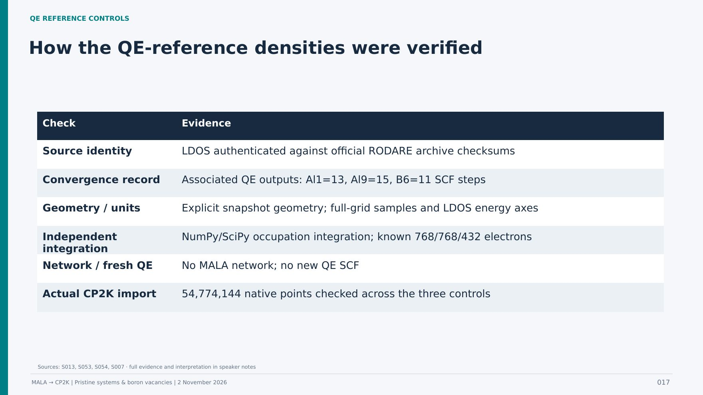

Check                                                Evidence  
Source identity                                      LDOS authenticated against official RODARE archive checksums  
Convergence record                                   Associated QE outputs: Al1=13, Al9=15, B6=11 SCF steps  
Geometry / units                                     Explicit snapshot geometry; full-grid samples and LDOS energy axes  
Independent                                          NumPy/SciPy occupation integration; known 768/768/432 electrons  
integration  
Network / fresh QE                                   No MALA network; no new QE SCF  
Actual CP2K import                                   54,774,144 native points checked across the three controls  
Sources: S013, S053, S054, S007 · full evidence and interpretation in speaker notes  

## 018 · Al 298 K · verified QE reference takes 14 steps

*QE REFERENCE CONTROLS*

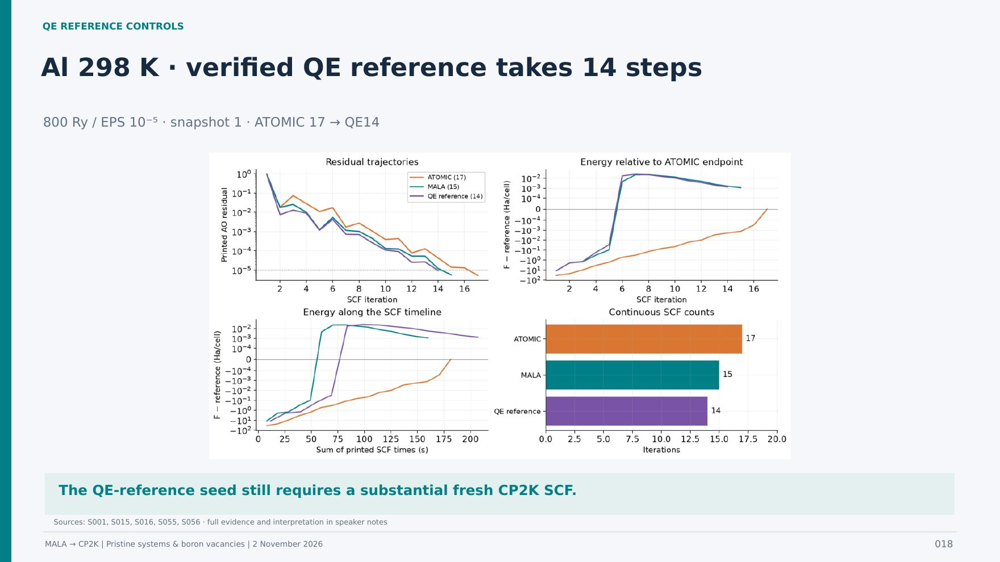

800 Ry / EPS 10⁻⁵ · snapshot 1 · ATOMIC 17 → QE14  
The QE-reference seed still requires a substantial fresh CP2K SCF.  
Sources: S001, S015, S016, S055, S056 · full evidence and interpretation in speaker notes  

## 019 · Al 933 K · verified QE reference takes 15 steps

*QE REFERENCE CONTROLS*

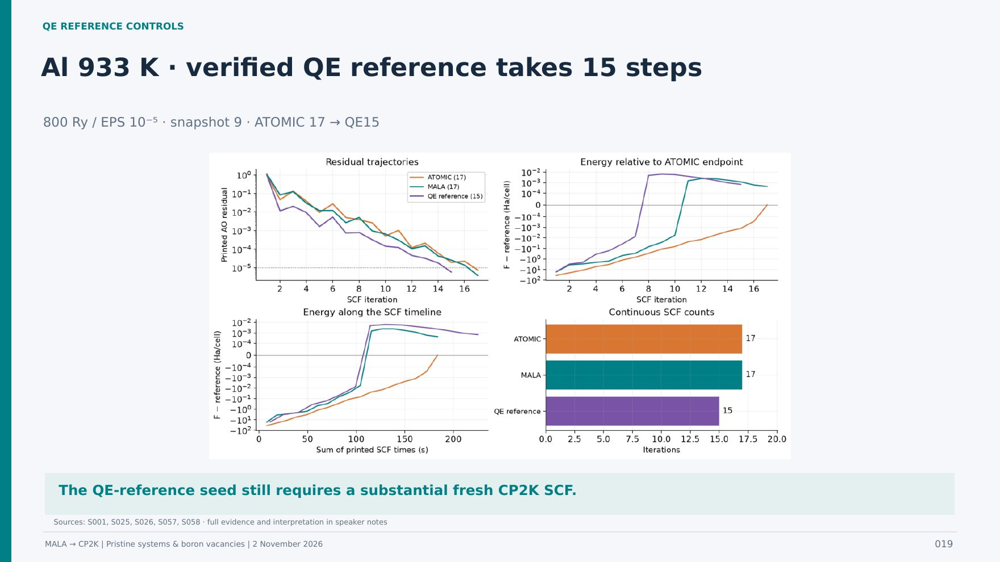

800 Ry / EPS 10⁻⁵ · snapshot 9 · ATOMIC 17 → QE15  
The QE-reference seed still requires a substantial fresh CP2K SCF.  
Sources: S001, S025, S026, S057, S058 · full evidence and interpretation in speaker notes  

## 020 · B 298 K · verified QE reference takes 12 steps

*QE REFERENCE CONTROLS*

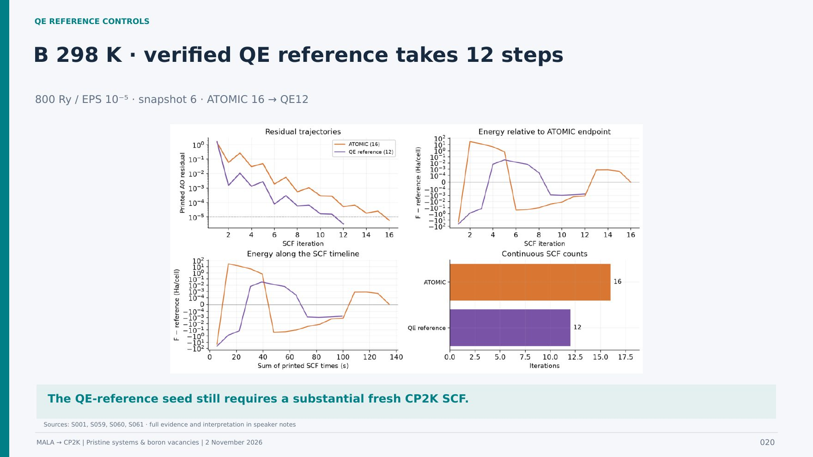

800 Ry / EPS 10⁻⁵ · snapshot 6 · ATOMIC 16 → QE12  
The QE-reference seed still requires a substantial fresh CP2K SCF.  
Sources: S001, S059, S060, S061 · full evidence and interpretation in speaker notes  

## 021 · QE transfer and CP2K reinjection answer different questions

*CONTROL INTERPRETATION*

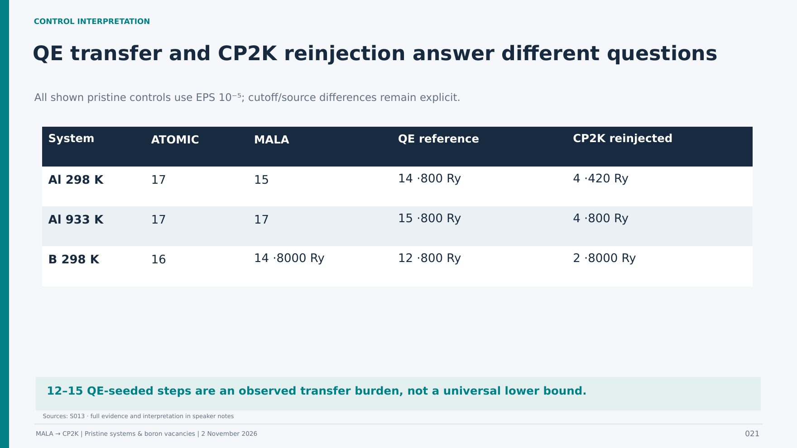

All shown pristine controls use EPS 10⁻⁵; cutoff/source differences remain explicit.  
System                             ATOMIC                          MALA          QE reference   CP2K reinjected  
Al 298 K                           17                              15            14 ·800 Ry     4 ·420 Ry  
Al 933 K                           17                              17            15 ·800 Ry     4 ·800 Ry  
B 298 K                            16                              14 ·8000 Ry   12 ·800 Ry     2 ·8000 Ry  
12–15 QE-seeded steps are an observed transfer burden, not a universal lower bound.  
Sources: S013 · full evidence and interpretation in speaker notes  

## 022 · Boron vacancies · why use a tighter SCF target?

*BORON VACANCIES*

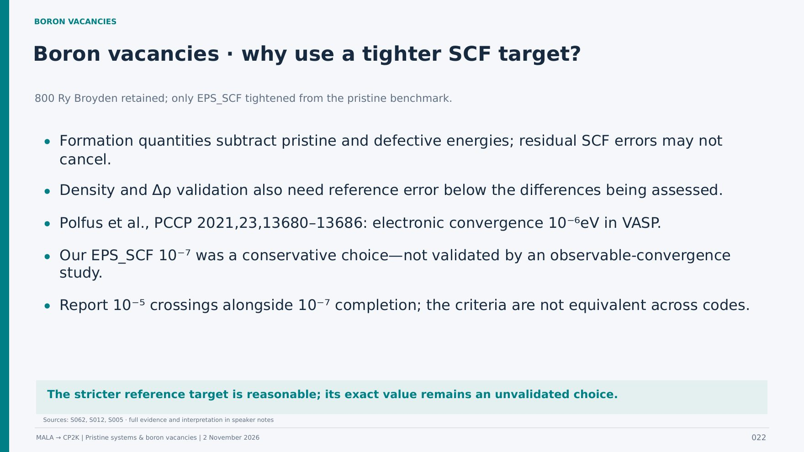

800 Ry Broyden retained; only EPS_SCF tightened from the pristine benchmark.  
- Formation quantities subtract pristine and defective energies; residual SCF errors may not
cancel.  
- Density and Δρ validation also need reference error below the differences being assessed.
- Polfus et al., PCCP 2021,23,13680–13686: electronic convergence 10⁻⁶eV in VASP.
- Our EPS_SCF 10⁻⁷ was a conservative choice—not validated by an observable-convergence
study.  
- Report 10⁻⁵ crossings alongside 10⁻⁷ completion; the criteria are not equivalent across codes.
The stricter reference target is reasonable; its exact value remains an unvalidated choice.  
Sources: S062, S012, S005 · full evidence and interpretation in speaker notes  

## 023 · Vacancy locations and configuration counts

*BORON VACANCIES*

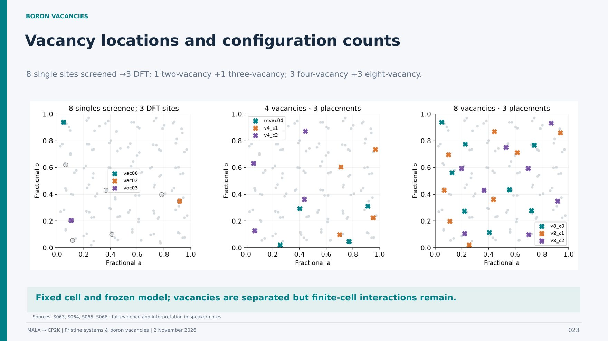

8 single sites screened →3 DFT; 1 two-vacancy +1 three-vacancy; 3 four-vacancy +3 eight-vacancy.  
Fixed cell and frozen model; vacancies are separated but finite-cell interactions remain.  
Sources: S063, S064, S065, S066 · full evidence and interpretation in speaker notes  

## 024 · B 298 K · Single vacancy · vac06 (high OOD)

*BORON VACANCY CASE*

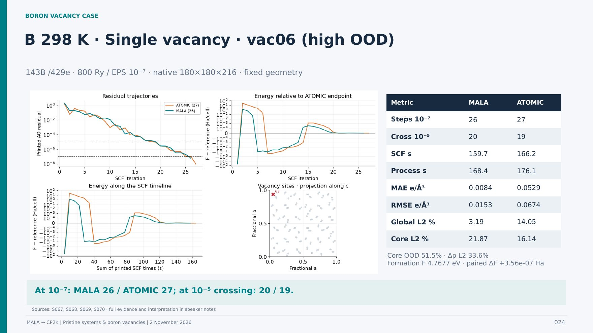

143B /429e · 800 Ry / EPS 10⁻⁷ · native 180×180×216 · fixed geometry  
Metric                MALA           ATOMIC  
Steps 10⁻⁷            26             27  
Cross 10⁻⁵            20             19  
SCF s                 159.7          166.2  
Process s             168.4          176.1  
MAE e/ų              0.0084         0.0529  
RMSE e/ų             0.0153         0.0674  
Global L2 %           3.19           14.05  
Core L2 %             21.87          16.14  
Core OOD 51.5% · Δρ L2 33.6%  
Formation F 4.7677 eV · paired ΔF +3.56e-07 Ha  
At 10⁻⁷: MALA 26 / ATOMIC 27; at 10⁻⁵ crossing: 20 / 19.  
Sources: S067, S068, S069, S070 · full evidence and interpretation in speaker notes  

## 025 · B 298 K · Single vacancy · vac02 (low OOD)

*BORON VACANCY CASE*

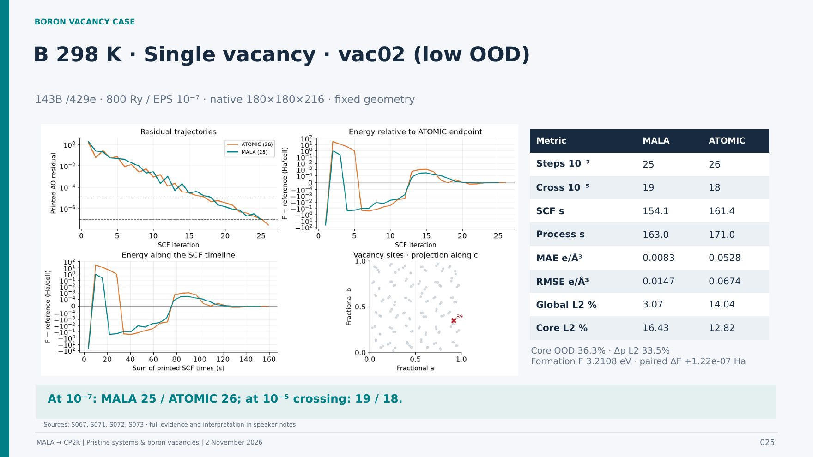

143B /429e · 800 Ry / EPS 10⁻⁷ · native 180×180×216 · fixed geometry  
Metric                MALA           ATOMIC  
Steps 10⁻⁷            25             26  
Cross 10⁻⁵            19             18  
SCF s                 154.1          161.4  
Process s             163.0          171.0  
MAE e/ų              0.0083         0.0528  
RMSE e/ų             0.0147         0.0674  
Global L2 %           3.07           14.04  
Core L2 %             16.43          12.82  
Core OOD 36.3% · Δρ L2 33.5%  
Formation F 3.2108 eV · paired ΔF +1.22e-07 Ha  
At 10⁻⁷: MALA 25 / ATOMIC 26; at 10⁻⁵ crossing: 19 / 18.  
Sources: S067, S071, S072, S073 · full evidence and interpretation in speaker notes  

## 026 · B 298 K · Single vacancy · vac03 (intermediate OOD)

*BORON VACANCY CASE*

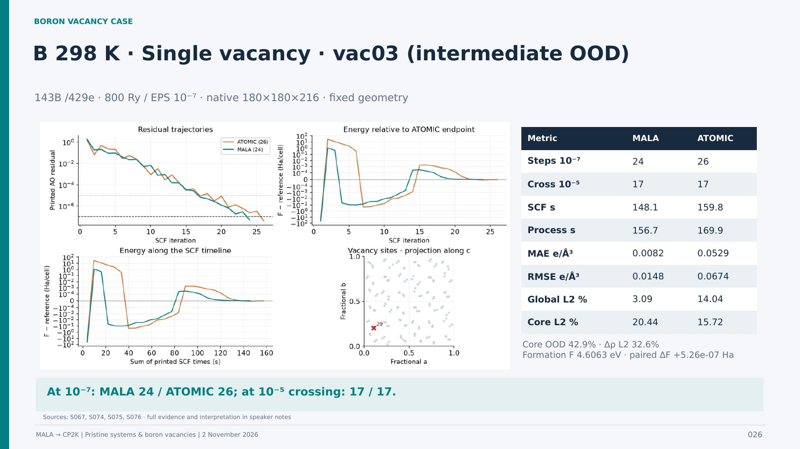

143B /429e · 800 Ry / EPS 10⁻⁷ · native 180×180×216 · fixed geometry  
Metric                MALA           ATOMIC  
Steps 10⁻⁷            24             26  
Cross 10⁻⁵            17             17  
SCF s                 148.1          159.8  
Process s             156.7          169.9  
MAE e/ų              0.0082         0.0529  
RMSE e/ų             0.0148         0.0674  
Global L2 %           3.09           14.04  
Core L2 %             20.44          15.72  
Core OOD 42.9% · Δρ L2 32.6%  
Formation F 4.6063 eV · paired ΔF +5.26e-07 Ha  
At 10⁻⁷: MALA 24 / ATOMIC 26; at 10⁻⁵ crossing: 17 / 17.  
Sources: S067, S074, S075, S076 · full evidence and interpretation in speaker notes  

## 027 · Single vacancies · density response and reinjection

*BORON VACANCY ANALYSIS*

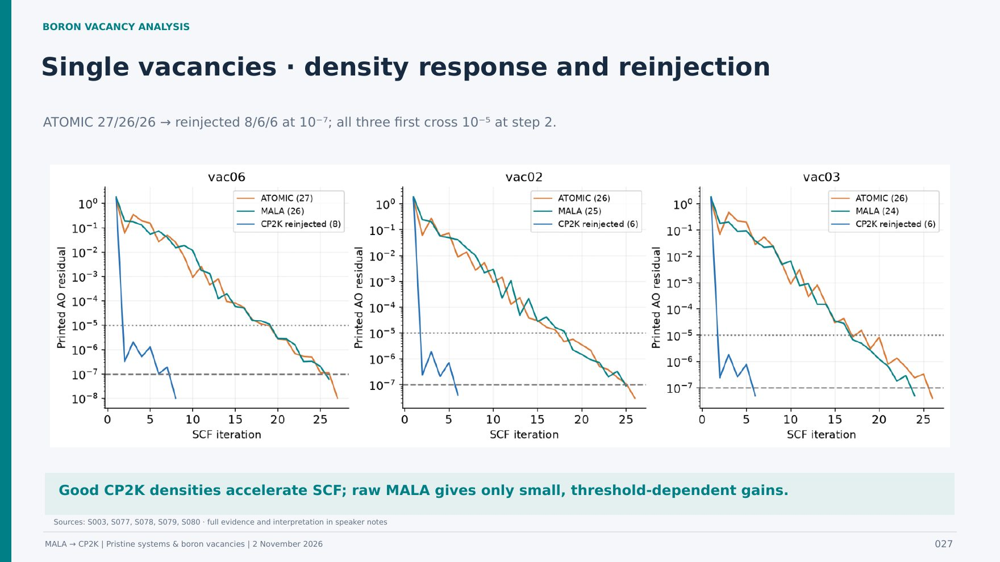

ATOMIC 27/26/26 → reinjected 8/6/6 at 10⁻⁷; all three first cross 10⁻⁵ at step 2.  
Good CP2K densities accelerate SCF; raw MALA gives only small, threshold-dependent gains.  
Sources: S003, S077, S078, S079, S080 · full evidence and interpretation in speaker notes  

## 028 · B 298 K · Two vacancies · maximum separation

*BORON VACANCY CASE*

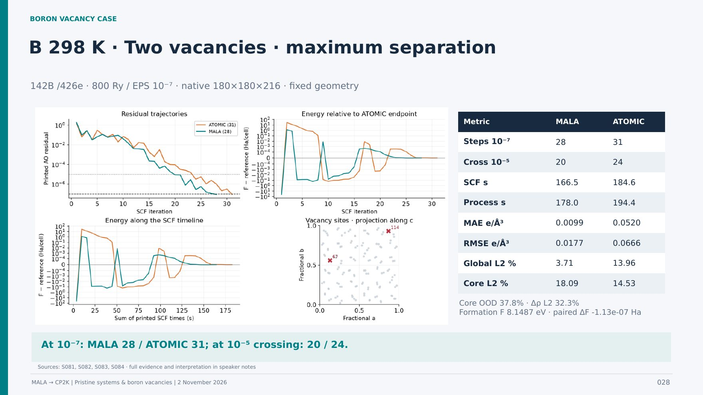

142B /426e · 800 Ry / EPS 10⁻⁷ · native 180×180×216 · fixed geometry  
Metric                 MALA          ATOMIC  
Steps 10⁻⁷             28            31  
Cross 10⁻⁵             20            24  
SCF s                  166.5         184.6  
Process s              178.0         194.4  
MAE e/ų               0.0099        0.0520  
RMSE e/ų              0.0177        0.0666  
Global L2 %            3.71          13.96  
Core L2 %              18.09         14.53  
Core OOD 37.8% · Δρ L2 32.3%  
Formation F 8.1487 eV · paired ΔF -1.13e-07 Ha  
At 10⁻⁷: MALA 28 / ATOMIC 31; at 10⁻⁵ crossing: 20 / 24.  
Sources: S081, S082, S083, S084 · full evidence and interpretation in speaker notes  

## 029 · B 298 K · Three vacancies · the difficult MALA case

*BORON VACANCY CASE*

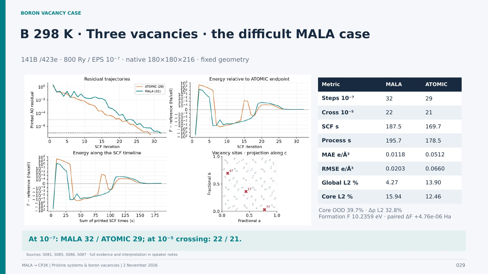

141B /423e · 800 Ry / EPS 10⁻⁷ · native 180×180×216 · fixed geometry  
Metric                MALA          ATOMIC  
Steps 10⁻⁷            32            29  
Cross 10⁻⁵            22            21  
SCF s                 187.5         169.7  
Process s             195.7         178.5  
MAE e/ų              0.0118        0.0512  
RMSE e/ų             0.0203        0.0660  
Global L2 %           4.27          13.90  
Core L2 %             15.94         12.46  
Core OOD 39.7% · Δρ L2 32.8%  
Formation F 10.2359 eV · paired ΔF +4.76e-06 Ha  
At 10⁻⁷: MALA 32 / ATOMIC 29; at 10⁻⁵ crossing: 22 / 21.  
Sources: S081, S085, S086, S087 · full evidence and interpretation in speaker notes  

## 030 · B 298 K · Four vacancies · placement A

*BORON VACANCY CASE*

140B /420e · 800 Ry / EPS 10⁻⁷ · native 180×180×216 · fixed geometry  
Metric                MALA          ATOMIC  
Steps 10⁻⁷            27            29  
Cross 10⁻⁵            20            19  
SCF s                 155.2         166.9  
Process s             163.7         176.1  
MAE e/ų              0.0135        0.0506  
RMSE e/ų             0.0230        0.0652  
Global L2 %           4.87          13.82  
Core L2 %             16.85         13.84  
Core OOD 40.8% · Δρ L2 31.6%  
Formation F 14.6486 eV · paired ΔF +2.48e-07 Ha  
At 10⁻⁷: MALA 27 / ATOMIC 29; at 10⁻⁵ crossing: 20 / 19.  
Sources: S081, S088, S089, S090 · full evidence and interpretation in speaker notes  

## 031 · B 298 K · Four vacancies · placement B

*BORON VACANCY CASE*

140B /420e · 800 Ry / EPS 10⁻⁷ · native 180×180×216 · fixed geometry  
Metric                 MALA          ATOMIC  
Steps 10⁻⁷             31            31  
Cross 10⁻⁵             21            21  
SCF s                  178.7         178.4  
Process s              187.0         187.7  
MAE e/ų               0.0132        0.0506  
RMSE e/ų              0.0226        0.0652  
Global L2 %            4.78          13.82  
Core L2 %              16.33         14.05  
Core OOD 36.2% · Δρ L2 30.7%  
Formation F 14.8603 eV · paired ΔF -1.41e-06 Ha  
At 10⁻⁷: MALA 31 / ATOMIC 31; at 10⁻⁵ crossing: 21 / 21.  
Sources: S091, S092, S093, S094 · full evidence and interpretation in speaker notes  

## 032 · B 298 K · Four vacancies · placement C

*BORON VACANCY CASE*

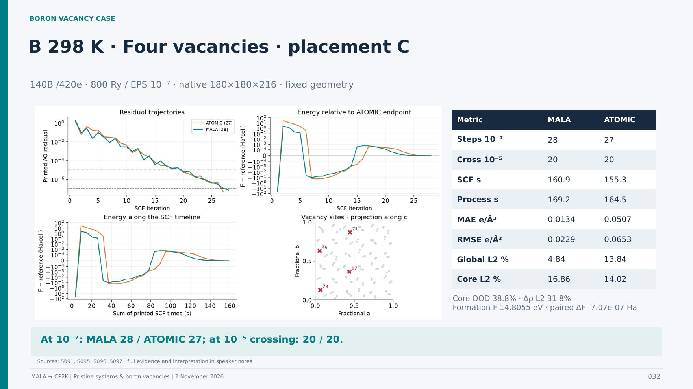

140B /420e · 800 Ry / EPS 10⁻⁷ · native 180×180×216 · fixed geometry  
Metric                 MALA          ATOMIC  
Steps 10⁻⁷             28            27  
Cross 10⁻⁵             20            20  
SCF s                  160.9         155.3  
Process s              169.2         164.5  
MAE e/ų               0.0134        0.0507  
RMSE e/ų              0.0229        0.0653  
Global L2 %            4.84          13.84  
Core L2 %              16.86         14.02  
Core OOD 38.8% · Δρ L2 31.8%  
Formation F 14.8055 eV · paired ΔF -7.07e-07 Ha  
At 10⁻⁷: MALA 28 / ATOMIC 27; at 10⁻⁵ crossing: 20 / 20.  
Sources: S091, S095, S096, S097 · full evidence and interpretation in speaker notes  

## 033 · B 298 K · Eight vacancies · placement A

*BORON VACANCY CASE*

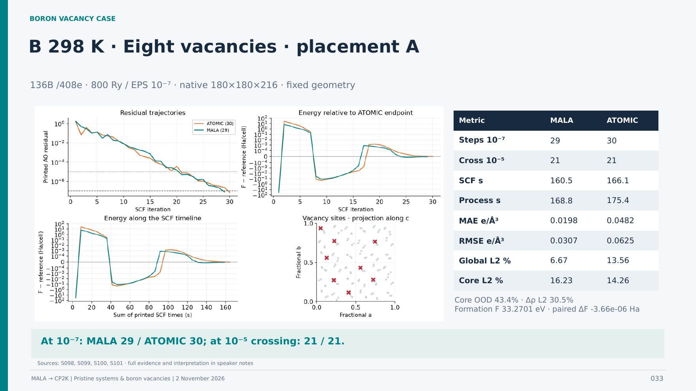

136B /408e · 800 Ry / EPS 10⁻⁷ · native 180×180×216 · fixed geometry  
Metric                 MALA          ATOMIC  
Steps 10⁻⁷             29            30  
Cross 10⁻⁵             21            21  
SCF s                  160.5         166.1  
Process s              168.8         175.4  
MAE e/ų               0.0198        0.0482  
RMSE e/ų              0.0307        0.0625  
Global L2 %            6.67          13.56  
Core L2 %              16.23         14.26  
Core OOD 43.4% · Δρ L2 30.5%  
Formation F 33.2701 eV · paired ΔF -3.66e-06 Ha  
At 10⁻⁷: MALA 29 / ATOMIC 30; at 10⁻⁵ crossing: 21 / 21.  
Sources: S098, S099, S100, S101 · full evidence and interpretation in speaker notes  

## 034 · B 298 K · Eight vacancies · placement B

*BORON VACANCY CASE*

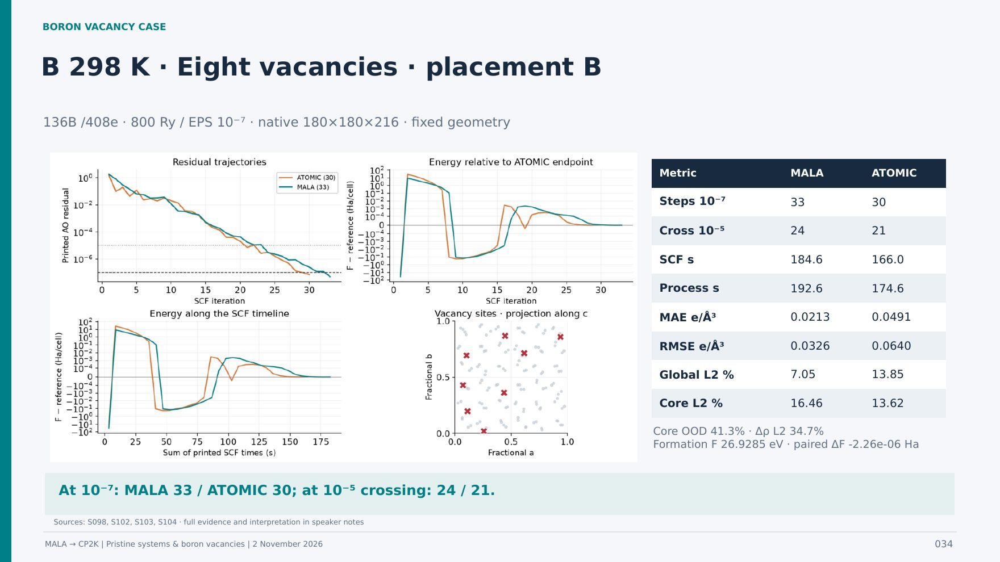

136B /408e · 800 Ry / EPS 10⁻⁷ · native 180×180×216 · fixed geometry  
Metric                 MALA          ATOMIC  
Steps 10⁻⁷             33            30  
Cross 10⁻⁵             24            21  
SCF s                  184.6         166.0  
Process s              192.6         174.6  
MAE e/ų               0.0213        0.0491  
RMSE e/ų              0.0326        0.0640  
Global L2 %            7.05          13.85  
Core L2 %              16.46         13.62  
Core OOD 41.3% · Δρ L2 34.7%  
Formation F 26.9285 eV · paired ΔF -2.26e-06 Ha  
At 10⁻⁷: MALA 33 / ATOMIC 30; at 10⁻⁵ crossing: 24 / 21.  
Sources: S098, S102, S103, S104 · full evidence and interpretation in speaker notes  

## 035 · B 298 K · Eight vacancies · placement C

*BORON VACANCY CASE*

136B /408e · 800 Ry / EPS 10⁻⁷ · native 180×180×216 · fixed geometry  
Metric                 MALA          ATOMIC  
Steps 10⁻⁷             30            30  
Cross 10⁻⁵             22            19  
SCF s                  166.5         166.4  
Process s              174.6         175.3  
MAE e/ų               0.0209        0.0490  
RMSE e/ų              0.0319        0.0637  
Global L2 %            6.90          13.79  
Core L2 %              16.32         13.35  
Core OOD 40.1% · Δρ L2 33.7%  
Formation F 26.9401 eV · paired ΔF -1.75e-06 Ha  
At 10⁻⁷: MALA 30 / ATOMIC 30; at 10⁻⁵ crossing: 22 / 19.  
Sources: S098, S105, S106, S107 · full evidence and interpretation in speaker notes  

## 036 · A physical atomic prior can complement MALA

*DENSITY BLENDING*

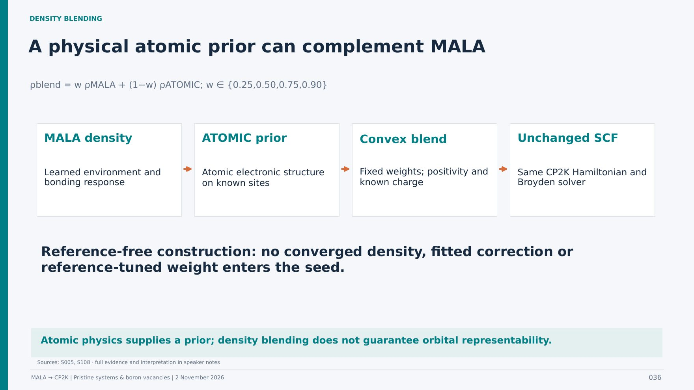

ρblend = w ρMALA + (1−w) ρATOMIC; w ∈ {0.25,0.50,0.75,0.90}  
MALA density                                                  ATOMIC prior                  Convex blend                    Unchanged SCF  
| Learned environment and | Atomic electronic structure | Fixed weights; positivity and | Same CP2K Hamiltonian and |
| --- | --- | --- | --- |
| bonding response | on known sites | known charge | Broyden solver |

Reference-free construction: no converged density, fitted correction or  
reference-tuned weight enters the seed.  
Atomic physics supplies a prior; density blending does not guarantee orbital representability.  
Sources: S005, S108 · full evidence and interpretation in speaker notes  

## 037 · Three vacancies · blending rescues the 32-step case

*BORON BLENDS*

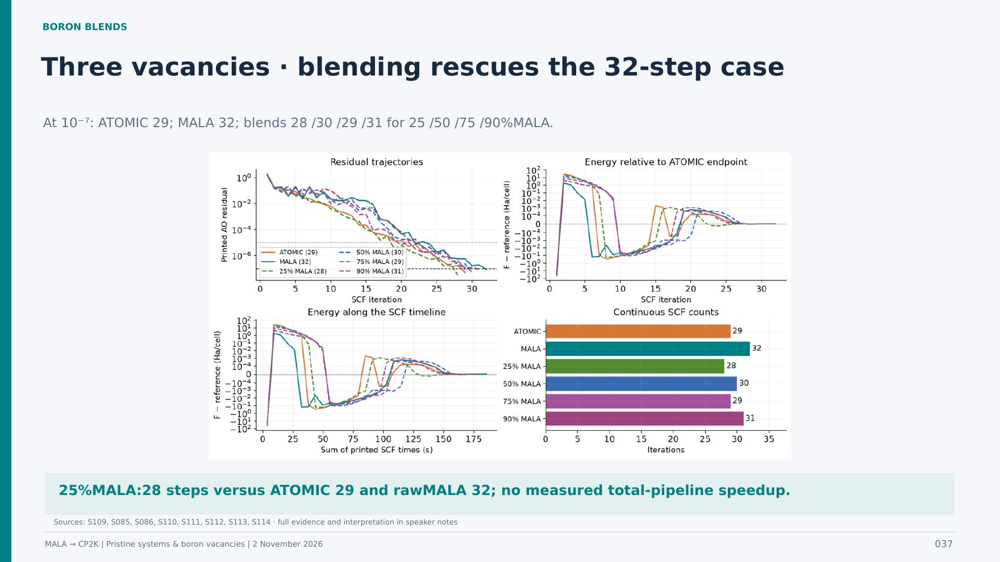

At 10⁻⁷: ATOMIC 29; MALA 32; blends 28 /30 /29 /31 for 25 /50 /75 /90%MALA.  
25%MALA:28 steps versus ATOMIC 29 and rawMALA 32; no measured total-pipeline speedup.  
Sources: S109, S085, S086, S110, S111, S112, S113, S114 · full evidence and interpretation in speaker notes  

## 038 · Four vacancies · blends help selected placements

*BORON BLENDS*

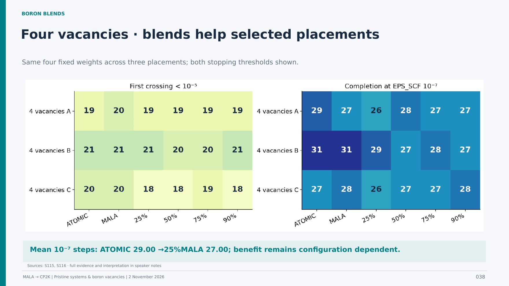

Same four fixed weights across three placements; both stopping thresholds shown.  
Mean 10⁻⁷ steps: ATOMIC 29.00 →25%MALA 27.00; benefit remains configuration dependent.  
Sources: S115, S116 · full evidence and interpretation in speaker notes  

## 039 · Eight vacancies · no consistently beneficial blend

*BORON BLENDS*

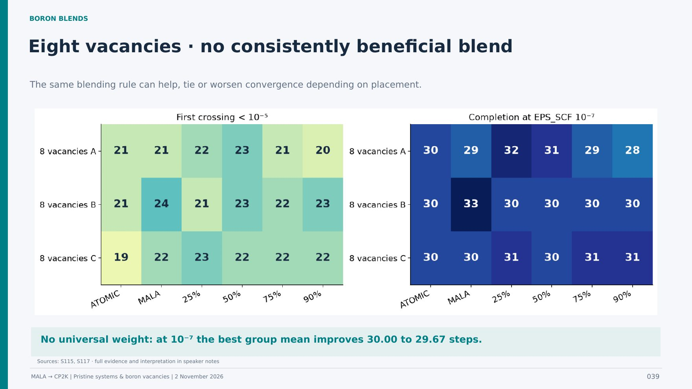

The same blending rule can help, tie or worsen convergence depending on placement.  
No universal weight: at 10⁻⁷ the best group mean improves 30.00 to 29.67 steps.  
Sources: S115, S117 · full evidence and interpretation in speaker notes  

## 040 · What the experiments support

*FINDINGS & LIMITS*

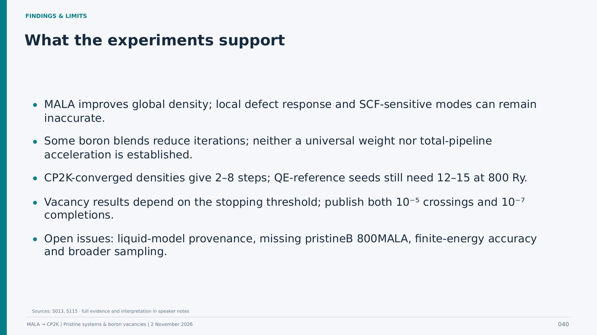

- MALA improves global density; local defect response and SCF-sensitive modes can remain
inaccurate.  
- Some boron blends reduce iterations; neither a universal weight nor total-pipeline
acceleration is established.  
- CP2K-converged densities give 2–8 steps; QE-reference seeds still need 12–15 at 800 Ry.
- Vacancy results depend on the stopping threshold; publish both 10⁻⁵ crossings and 10⁻⁷
completions.  
- Open issues: liquid-model provenance, missing pristineB 800MALA, finite-energy accuracy
and broader sampling.  
Sources: S013, S115 · full evidence and interpretation in speaker notes  

## 041 · Al 298 K · complete pristine numerical record

*APPENDIX · PRISTINE*

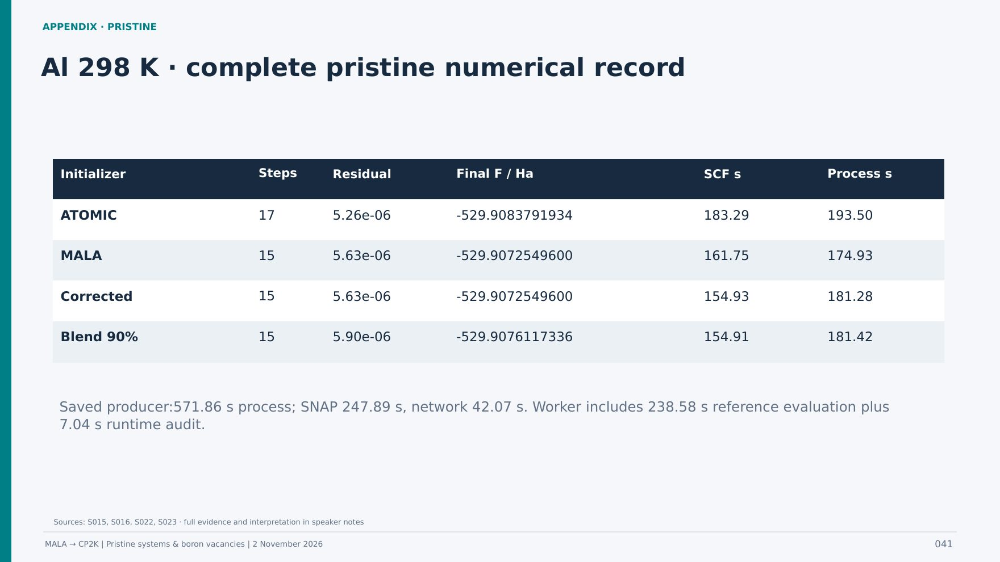

Initializer                                          Steps               Residual    Final F / Ha      SCF s    Process s  
ATOMIC                                               17                  5.26e-06    -529.9083791934   183.29   193.50  
MALA                                                 15                  5.63e-06    -529.9072549600   161.75   174.93  
Corrected                                            15                  5.63e-06    -529.9072549600   154.93   181.28  
Blend 90%                                            15                  5.90e-06    -529.9076117336   154.91   181.42  
Saved producer:571.86 s process; SNAP 247.89 s, network 42.07 s. Worker includes 238.58 s reference evaluation plus  
7.04 s runtime audit.  
Sources: S015, S016, S022, S023 · full evidence and interpretation in speaker notes  

## 042 · Al 933 K · complete pristine numerical record

*APPENDIX · PRISTINE*

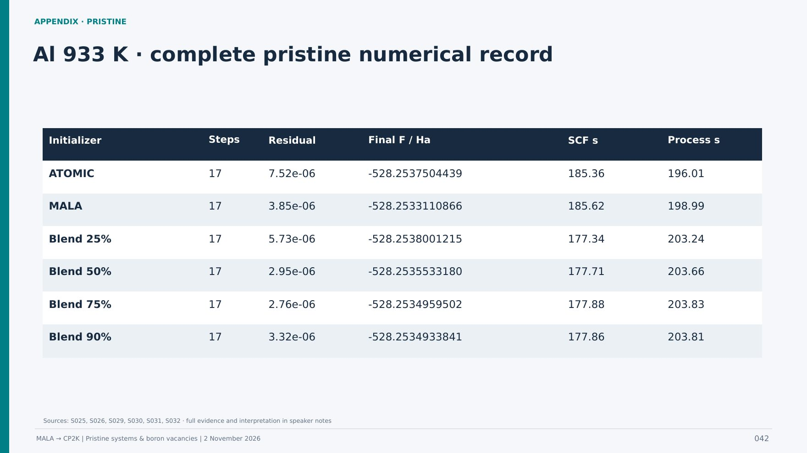

Initializer                                          Steps               Residual                Final F / Ha      SCF s    Process s  
ATOMIC                                               17                  7.52e-06                -528.2537504439   185.36   196.01  
MALA                                                 17                  3.85e-06                -528.2533110866   185.62   198.99  
Blend 25%                                            17                  5.73e-06                -528.2538001215   177.34   203.24  
Blend 50%                                            17                  2.95e-06                -528.2535533180   177.71   203.66  
Blend 75%                                            17                  2.76e-06                -528.2534959502   177.88   203.83  
Blend 90%                                            17                  3.32e-06                -528.2534933841   177.86   203.81  
Sources: S025, S026, S029, S030, S031, S032 · full evidence and interpretation in speaker notes  

## 043 · B 298 K · separate 8000/800-Ry records

*APPENDIX · PRISTINE*

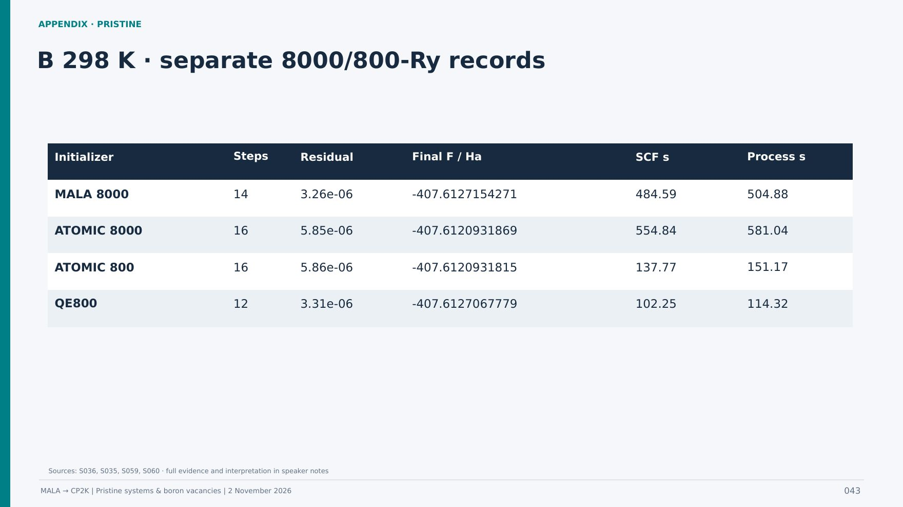

Initializer                                          Steps               Residual    Final F / Ha      SCF s    Process s  
MALA 8000                                            14                  3.26e-06    -407.6127154271   484.59   504.88  
ATOMIC 8000                                          16                  5.85e-06    -407.6120931869   554.84   581.04  
ATOMIC 800                                           16                  5.86e-06    -407.6120931815   137.77   151.17  
QE800                                                12                  3.31e-06    -407.6127067779   102.25   114.32  
Sources: S036, S035, S059, S060 · full evidence and interpretation in speaker notes  

## 044 · Al 298 K · initial density accuracy against the tighter reference

*APPENDIX · DENSITY ACCURACY*

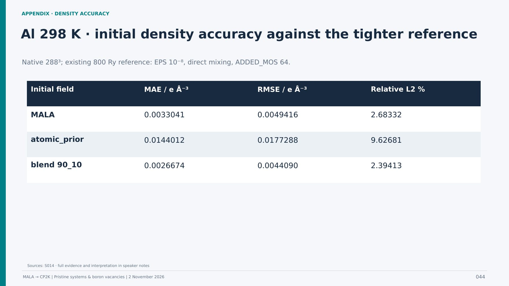

Native 288³; existing 800 Ry reference: EPS 10⁻⁸, direct mixing, ADDED_MOS 64.  
Initial field                                                MAE / e Å⁻³   RMSE / e Å⁻³   Relative L2 %  
MALA                                                         0.0033041     0.0049416      2.68332  
atomic_prior                                                 0.0144012     0.0177288      9.62681  
blend 90_10                                                  0.0026674     0.0044090      2.39413  
Sources: S014 · full evidence and interpretation in speaker notes  

## 045 · Al 933 K · blend density accuracy against the saved ATOMIC

*APPENDIX · DENSITY ACCURACY*

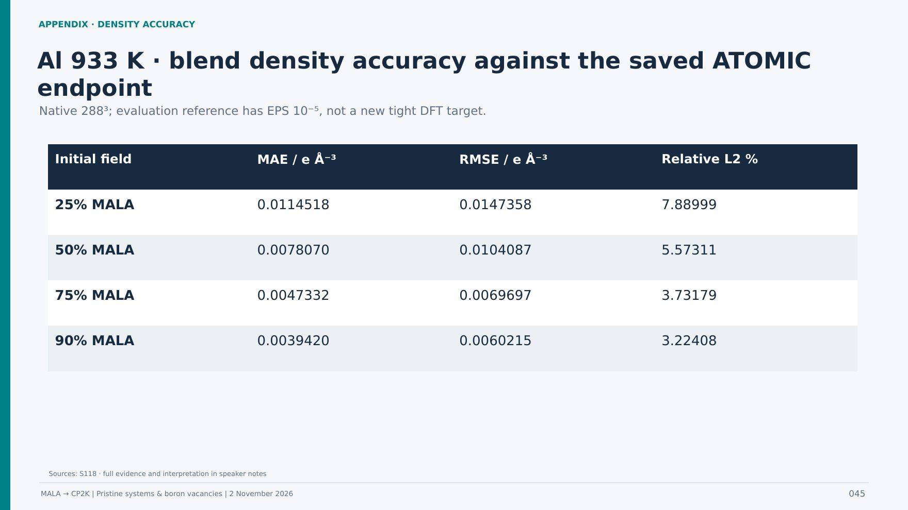

endpoint  
Native 288³; evaluation reference has EPS 10⁻⁵, not a new tight DFT target.  
Initial field                                                MAE / e Å⁻³   RMSE / e Å⁻³   Relative L2 %  
25% MALA                                                     0.0114518     0.0147358      7.88999  
50% MALA                                                     0.0078070     0.0104087      5.57311  
75% MALA                                                     0.0047332     0.0069697      3.73179  
90% MALA                                                     0.0039420     0.0060215      3.22408  
Sources: S118 · full evidence and interpretation in speaker notes  

## 046 · B 298 K · separate pristine density evaluation at 800 Ry

*APPENDIX · DENSITY ACCURACY*

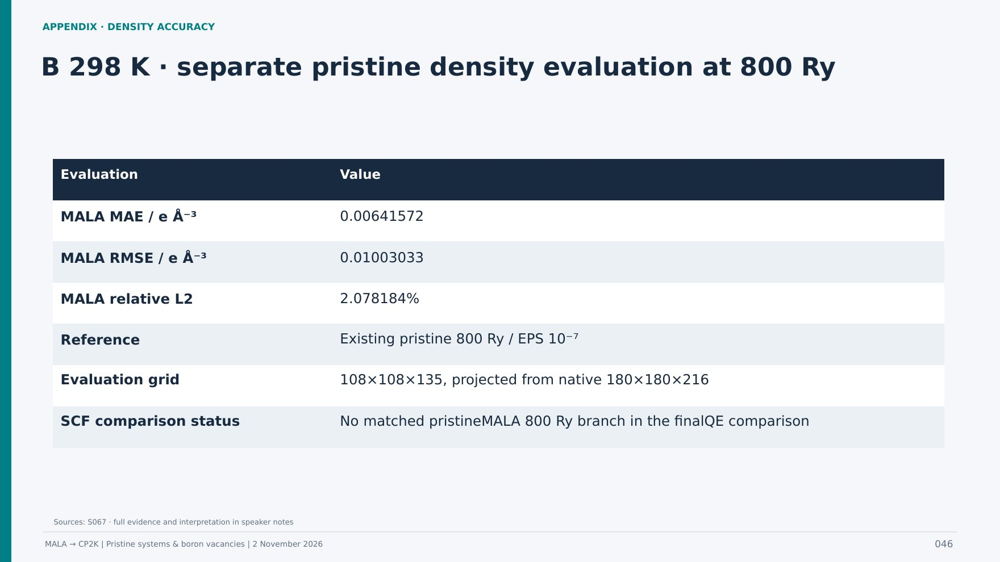

Evaluation                                                         Value  
MALA MAE / e Å⁻³                                                   0.00641572  
MALA RMSE / e Å⁻³                                                  0.01003033  
MALA relative L2                                                   2.078184%  
Reference                                                          Existing pristine 800 Ry / EPS 10⁻⁷  
Evaluation grid                                                    108×108×135, projected from native 180×180×216  
SCF comparison status                                              No matched pristineMALA 800 Ry branch in the finalQE comparison  
Sources: S067 · full evidence and interpretation in speaker notes  

## 047 · CP2K-density reinjection · numerical records

*APPENDIX · REINJECTION*

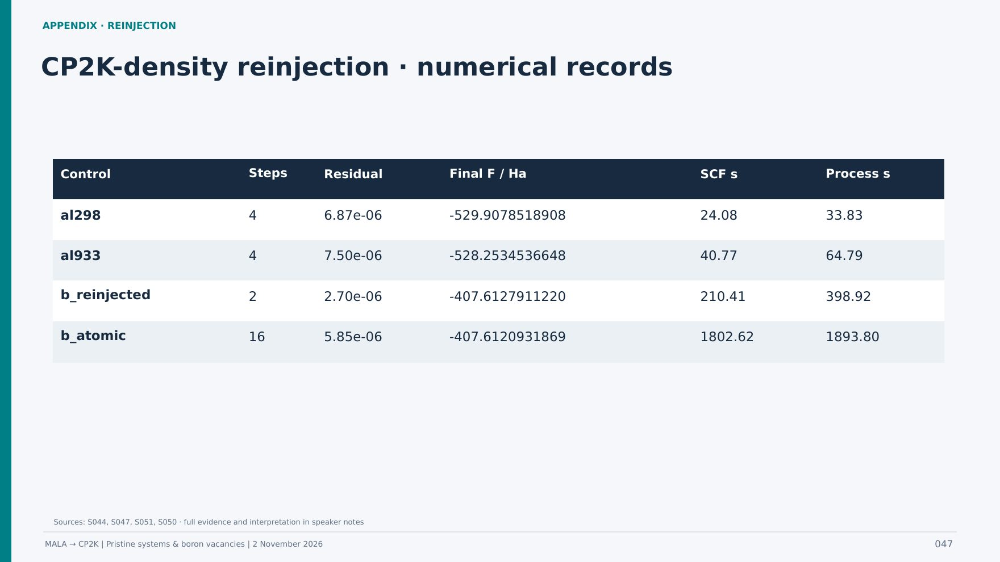

Control                                            Steps               Residual      Final F / Ha      SCF s     Process s  
al298                                              4                   6.87e-06      -529.9078518908   24.08     33.83  
al933                                              4                   7.50e-06      -528.2534536648   40.77     64.79  
b_reinjected                                       2                   2.70e-06      -407.6127911220   210.41    398.92  
b_atomic                                           16                  5.85e-06      -407.6120931869   1802.62   1893.80  
Sources: S044, S047, S051, S050 · full evidence and interpretation in speaker notes  

## 048 · QE controls · final agreement and transfer checks

*APPENDIX · QE*

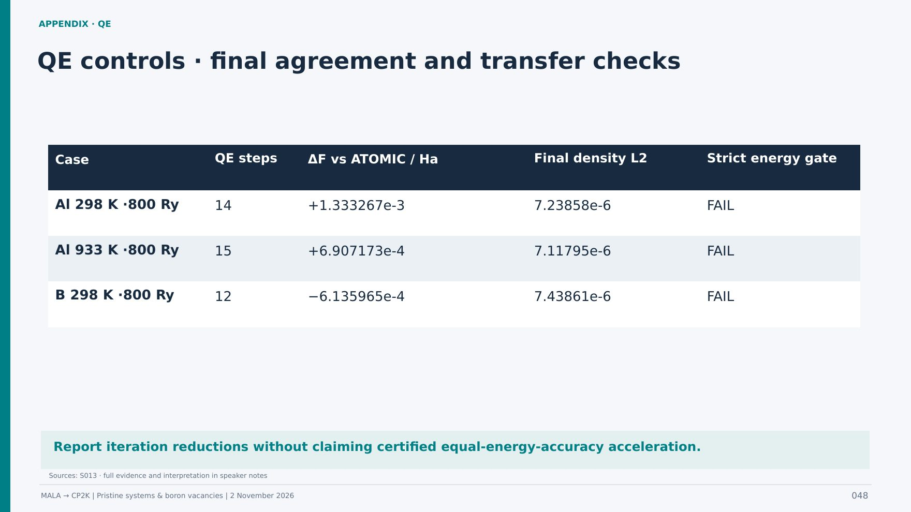

Case                                            QE steps           ΔF vs ATOMIC / Ha   Final density L2   Strict energy gate  
Al 298 K ·800 Ry                                14                 +1.333267e-3        7.23858e-6         FAIL  
Al 933 K ·800 Ry                                15                 +6.907173e-4        7.11795e-6         FAIL  
B 298 K ·800 Ry                                 12                 −6.135965e-4        7.43861e-6         FAIL  
Report iteration reductions without claiming certified equal-energy-accuracy acceleration.  
Sources: S013 · full evidence and interpretation in speaker notes  

## 049 · B 298 K · Single vacancy · vac06 (high OOD) · numbers

*APPENDIX · CASE RECORD*

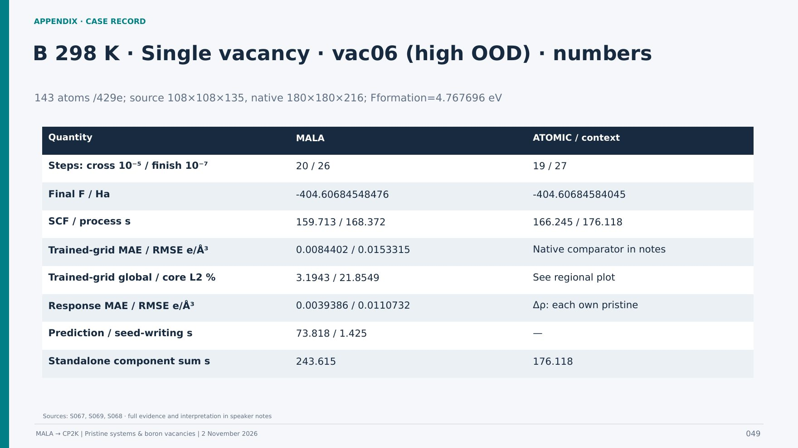

143 atoms /429e; source 108×108×135, native 180×180×216; Fformation=4.767696 eV  
Quantity                                                                       MALA                    ATOMIC / context  
Steps: cross 10⁻⁵ / finish 10⁻⁷                                                20 / 26                 19 / 27  
Final F / Ha                                                                   -404.60684548476        -404.60684584045  
SCF / process s                                                                159.713 / 168.372       166.245 / 176.118  
Trained-grid MAE / RMSE e/ų                                                   0.0084402 / 0.0153315   Native comparator in notes  
Trained-grid global / core L2 %                                                3.1943 / 21.8549        See regional plot  
Response MAE / RMSE e/ų                                                       0.0039386 / 0.0110732   Δρ: each own pristine  
Prediction / seed-writing s                                                    73.818 / 1.425          —  
Standalone component sum s                                                     243.615                 176.118  
Sources: S067, S069, S068 · full evidence and interpretation in speaker notes  

## 050 · B 298 K · Single vacancy · vac02 (low OOD) · numbers

*APPENDIX · CASE RECORD*

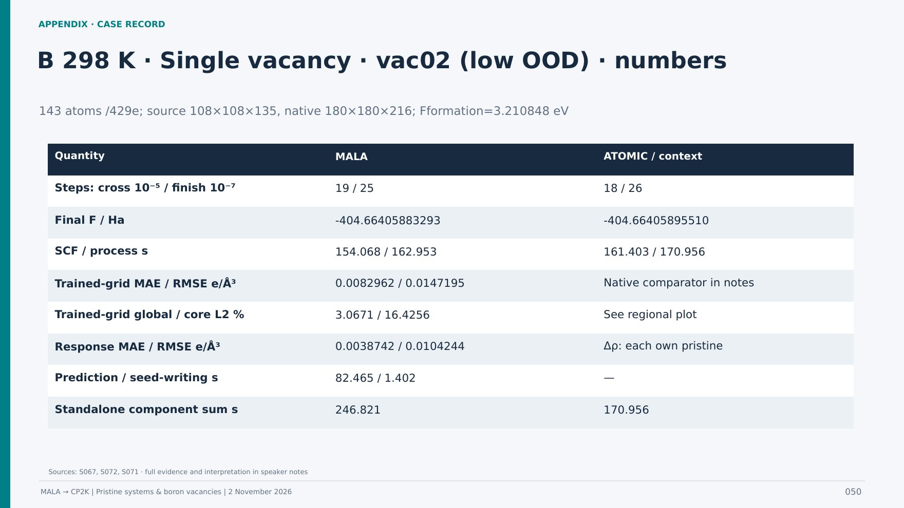

143 atoms /429e; source 108×108×135, native 180×180×216; Fformation=3.210848 eV  
Quantity                                                                       MALA                    ATOMIC / context  
Steps: cross 10⁻⁵ / finish 10⁻⁷                                                19 / 25                 18 / 26  
Final F / Ha                                                                   -404.66405883293        -404.66405895510  
SCF / process s                                                                154.068 / 162.953       161.403 / 170.956  
Trained-grid MAE / RMSE e/ų                                                   0.0082962 / 0.0147195   Native comparator in notes  
Trained-grid global / core L2 %                                                3.0671 / 16.4256        See regional plot  
Response MAE / RMSE e/ų                                                       0.0038742 / 0.0104244   Δρ: each own pristine  
Prediction / seed-writing s                                                    82.465 / 1.402          —  
Standalone component sum s                                                     246.821                 170.956  
Sources: S067, S072, S071 · full evidence and interpretation in speaker notes  

## 051 · B 298 K · Single vacancy · vac03 (intermediate OOD) · numbers

*APPENDIX · CASE RECORD*

143 atoms /429e; source 108×108×135, native 180×180×216; Fformation=4.606265 eV  
Quantity                                                                       MALA                    ATOMIC / context  
Steps: cross 10⁻⁵ / finish 10⁻⁷                                                17 / 24                 17 / 26  
Final F / Ha                                                                   -404.61277782219        -404.61277834801  
SCF / process s                                                                148.113 / 156.712       159.831 / 169.893  
Trained-grid MAE / RMSE e/ų                                                   0.0082422 / 0.0148349   Native comparator in notes  
Trained-grid global / core L2 %                                                3.0908 / 20.4204        See regional plot  
Response MAE / RMSE e/ų                                                       0.0037666 / 0.0107558   Δρ: each own pristine  
Prediction / seed-writing s                                                    72.149 / 1.382          —  
Standalone component sum s                                                     230.243                 169.893  
Sources: S067, S075, S074 · full evidence and interpretation in speaker notes  

## 052 · B 298 K · Two vacancies · maximum separation · numbers

*APPENDIX · CASE RECORD*

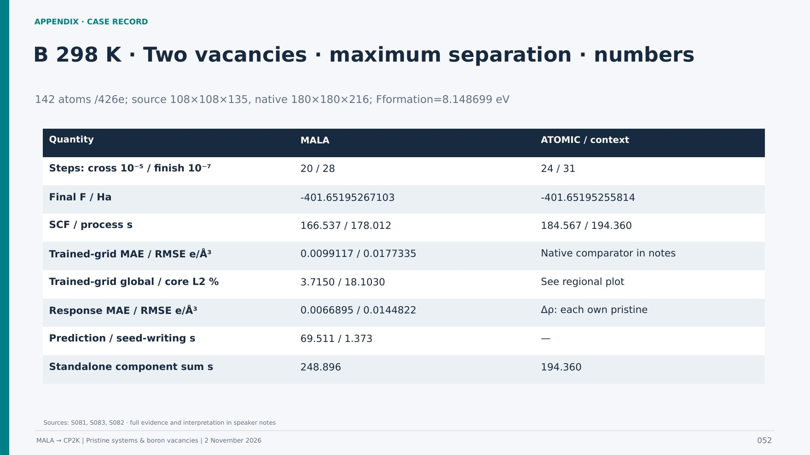

142 atoms /426e; source 108×108×135, native 180×180×216; Fformation=8.148699 eV  
Quantity                                                                       MALA                    ATOMIC / context  
Steps: cross 10⁻⁵ / finish 10⁻⁷                                                20 / 28                 24 / 31  
Final F / Ha                                                                   -401.65195267103        -401.65195255814  
SCF / process s                                                                166.537 / 178.012       184.567 / 194.360  
Trained-grid MAE / RMSE e/ų                                                   0.0099117 / 0.0177335   Native comparator in notes  
Trained-grid global / core L2 %                                                3.7150 / 18.1030        See regional plot  
Response MAE / RMSE e/ų                                                       0.0066895 / 0.0144822   Δρ: each own pristine  
Prediction / seed-writing s                                                    69.511 / 1.373          —  
Standalone component sum s                                                     248.896                 194.360  
Sources: S081, S083, S082 · full evidence and interpretation in speaker notes  

## 053 · B 298 K · Three vacancies · the difficult MALA case · numbers

*APPENDIX · CASE RECORD*

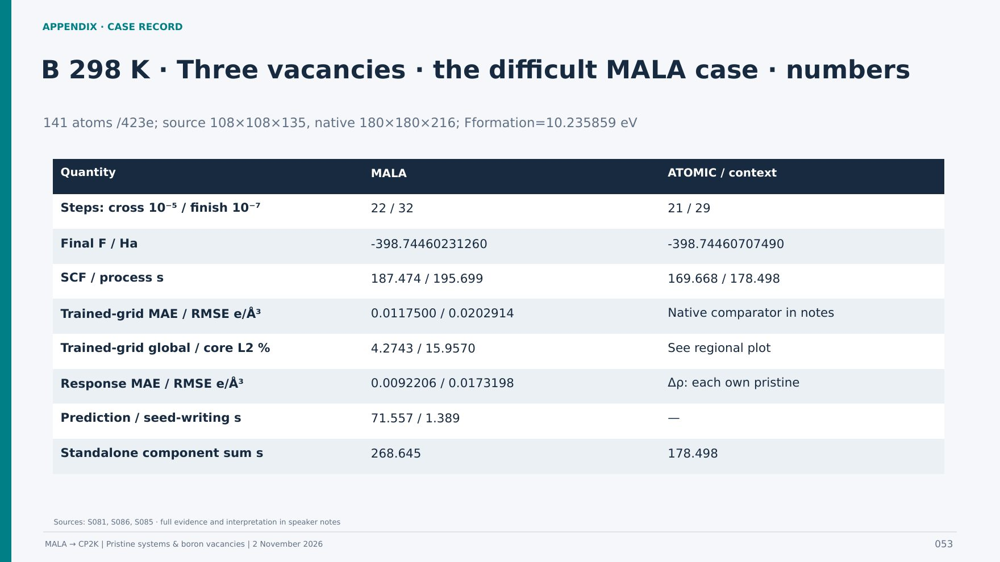

141 atoms /423e; source 108×108×135, native 180×180×216; Fformation=10.235859 eV  
Quantity                                                                       MALA                    ATOMIC / context  
Steps: cross 10⁻⁵ / finish 10⁻⁷                                                22 / 32                 21 / 29  
Final F / Ha                                                                   -398.74460231260        -398.74460707490  
SCF / process s                                                                187.474 / 195.699       169.668 / 178.498  
Trained-grid MAE / RMSE e/ų                                                   0.0117500 / 0.0202914   Native comparator in notes  
Trained-grid global / core L2 %                                                4.2743 / 15.9570        See regional plot  
Response MAE / RMSE e/ų                                                       0.0092206 / 0.0173198   Δρ: each own pristine  
Prediction / seed-writing s                                                    71.557 / 1.389          —  
Standalone component sum s                                                     268.645                 178.498  
Sources: S081, S086, S085 · full evidence and interpretation in speaker notes  

## 054 · B 298 K · Four vacancies · placement A · numbers

*APPENDIX · CASE RECORD*

140 atoms /420e; source 108×108×135, native 180×180×216; Fformation=14.648599 eV  
Quantity                                                                       MALA                    ATOMIC / context  
Steps: cross 10⁻⁵ / finish 10⁻⁷                                                20 / 27                 19 / 29  
Final F / Ha                                                                   -395.75179787156        -395.75179811954  
SCF / process s                                                                155.231 / 163.734       166.928 / 176.147  
Trained-grid MAE / RMSE e/ų                                                   0.0134951 / 0.0229826   Native comparator in notes  
Trained-grid global / core L2 %                                                4.8701 / 16.8449        See regional plot  
Response MAE / RMSE e/ų                                                       0.0113226 / 0.0201334   Δρ: each own pristine  
Prediction / seed-writing s                                                    68.713 / 1.369          —  
Standalone component sum s                                                     233.815                 176.147  
Sources: S081, S089, S088 · full evidence and interpretation in speaker notes  

## 055 · B 298 K · Four vacancies · placement B · numbers

*APPENDIX · CASE RECORD*

140 atoms /420e; source 108×108×135, native 180×180×216; Fformation=14.860311 eV  
Quantity                                                                       MALA                    ATOMIC / context  
Steps: cross 10⁻⁵ / finish 10⁻⁷                                                21 / 31                 21 / 31  
Final F / Ha                                                                   -395.74401925902        -395.74401785339  
SCF / process s                                                                178.696 / 187.005       178.407 / 187.679  
Trained-grid MAE / RMSE e/ų                                                   0.0131713 / 0.0225648   Native comparator in notes  
Trained-grid global / core L2 %                                                4.7827 / 16.3381        See regional plot  
Response MAE / RMSE e/ų                                                       0.0110084 / 0.0196096   Δρ: each own pristine  
Prediction / seed-writing s                                                    76.264 / 1.359          —  
Standalone component sum s                                                     264.628                 187.679  
Sources: S091, S093, S092 · full evidence and interpretation in speaker notes  

## 056 · B 298 K · Four vacancies · placement C · numbers

*APPENDIX · CASE RECORD*

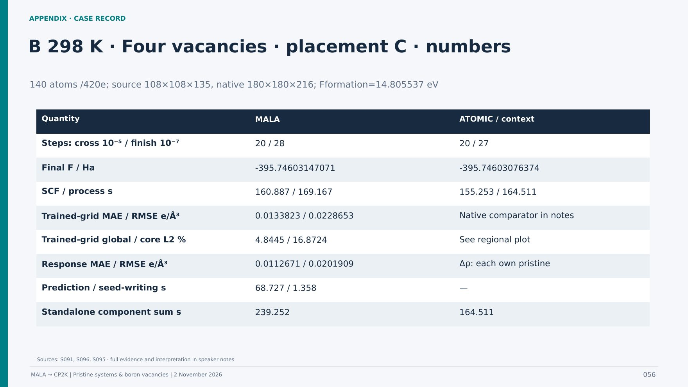

140 atoms /420e; source 108×108×135, native 180×180×216; Fformation=14.805537 eV  
Quantity                                                                       MALA                    ATOMIC / context  
Steps: cross 10⁻⁵ / finish 10⁻⁷                                                20 / 28                 20 / 27  
Final F / Ha                                                                   -395.74603147071        -395.74603076374  
SCF / process s                                                                160.887 / 169.167       155.253 / 164.511  
Trained-grid MAE / RMSE e/ų                                                   0.0133823 / 0.0228653   Native comparator in notes  
Trained-grid global / core L2 %                                                4.8445 / 16.8724        See regional plot  
Response MAE / RMSE e/ų                                                       0.0112671 / 0.0201909   Δρ: each own pristine  
Prediction / seed-writing s                                                    68.727 / 1.358          —  
Standalone component sum s                                                     239.252                 164.511  
Sources: S091, S096, S095 · full evidence and interpretation in speaker notes  

## 057 · B 298 K · Eight vacancies · placement A · numbers

*APPENDIX · CASE RECORD*

136 atoms /408e; source 108×108×135, native 180×180×216; Fformation=33.270091 eV  
Quantity                                                                       MALA                    ATOMIC / context  
Steps: cross 10⁻⁵ / finish 10⁻⁷                                                21 / 29                 21 / 30  
Final F / Ha                                                                   -383.74489960755        -383.74489594706  
SCF / process s                                                                160.540 / 168.790       166.112 / 175.421  
Trained-grid MAE / RMSE e/ų                                                   0.0197709 / 0.0307246   Native comparator in notes  
Trained-grid global / core L2 %                                                6.6670 / 16.2315        See regional plot  
Response MAE / RMSE e/ų                                                       0.0185078 / 0.0282247   Δρ: each own pristine  
Prediction / seed-writing s                                                    68.467 / 1.383          —  
Standalone component sum s                                                     238.641                 175.421  
Sources: S098, S100, S099 · full evidence and interpretation in speaker notes  

## 058 · B 298 K · Eight vacancies · placement B · numbers

*APPENDIX · CASE RECORD*

136 atoms /408e; source 108×108×135, native 180×180×216; Fformation=26.928467 eV  
Quantity                                                                       MALA                    ATOMIC / context  
Steps: cross 10⁻⁵ / finish 10⁻⁷                                                24 / 33                 21 / 30  
Final F / Ha                                                                   -383.97794858254        -383.97794632053  
SCF / process s                                                                184.618 / 192.631       165.978 / 174.590  
Trained-grid MAE / RMSE e/ų                                                   0.0212926 / 0.0325584   Native comparator in notes  
Trained-grid global / core L2 %                                                7.0474 / 16.4584        See regional plot  
Response MAE / RMSE e/ų                                                       0.0201186 / 0.0304550   Δρ: each own pristine  
Prediction / seed-writing s                                                    68.589 / 1.376          —  
Standalone component sum s                                                     262.595                 174.590  
Sources: S098, S103, S102 · full evidence and interpretation in speaker notes  

## 059 · B 298 K · Eight vacancies · placement C · numbers

*APPENDIX · CASE RECORD*

136 atoms /408e; source 108×108×135, native 180×180×216; Fformation=26.940137 eV  
Quantity                                                                       MALA                    ATOMIC / context  
Steps: cross 10⁻⁵ / finish 10⁻⁷                                                22 / 30                 19 / 30  
Final F / Ha                                                                   -383.97751921473        -383.97751746486  
SCF / process s                                                                166.460 / 174.569       166.362 / 175.290  
Trained-grid MAE / RMSE e/ų                                                   0.0208820 / 0.0318633   Native comparator in notes  
Trained-grid global / core L2 %                                                6.8963 / 16.3189        See regional plot  
Response MAE / RMSE e/ų                                                       0.0195759 / 0.0295438   Δρ: each own pristine  
Prediction / seed-writing s                                                    70.107 / 1.378          —  
Standalone component sum s                                                     246.054                 175.290  
Sources: S098, S106, S105 · full evidence and interpretation in speaker notes  

## 060 · B 298 K · Three vacancies · the difficult MALA case · all blend

*APPENDIX · BLENDS*

trajectories  
Four fixed weights; raw MALA and ATOMIC also appear in the figure. EPS 10⁻⁷; dotted 10⁻⁵ line.  
Sources: S108, S085, S110, S111, S112, S113, S114 · full evidence and interpretation in speaker notes  

## 061 · B 298 K · Three vacancies · the difficult MALA case · blend

*APPENDIX · BLEND METRICS*

accuracy  
Both initializers and all four blends evaluated on the same native 180×180×216 grid.  
Seed                                    MAE e/ų                   RMSE e/ų   Global L2 %   Core L2 %   Final ΔF/Ha   Prep s  
MALA                                    0.01175                    0.02029     4.274         15.943      4.76e-06      0.00  
ATOMIC                                  0.05124                    0.06600     13.903        12.456      0.00e+00      0.00  
25% MALA                                0.03875                    0.04997     10.526        11.769      2.73e-06      6.11  
50% MALA                                0.02677                    0.03493     7.357         12.226      4.07e-06      6.15  
75% MALA                                0.01614                    0.02291     4.826         13.713      1.12e-06      6.18  
90% MALA                                0.01193                    0.01968     4.144         14.980      3.05e-06      6.20  
Sources: S108 · full evidence and interpretation in speaker notes  

## 062 · B 298 K · Four vacancies · placement A · all blend trajectories

*APPENDIX · BLENDS*

Four fixed weights; raw MALA and ATOMIC also appear in the figure. EPS 10⁻⁷; dotted 10⁻⁵ line.  
Sources: S115, S088, S119, S120, S121, S122, S123 · full evidence and interpretation in speaker notes  

## 063 · B 298 K · Four vacancies · placement A · blend accuracy

*APPENDIX · BLEND METRICS*

Both initializers and all four blends evaluated on the same native 180×180×216 grid.  
Seed                                    MAE e/ų                   RMSE e/ų   Global L2 %   Core L2 %   Final ΔF/Ha   Prep s  
MALA                                    0.01350                    0.02298     4.870         16.847      2.48e-07      0.00  
ATOMIC                                  0.05060                    0.06523     13.822        13.842      0.00e+00      0.00  
25% MALA                                0.03858                    0.04986     10.565        13.166      -2.17e-06     6.15  
50% MALA                                0.02718                    0.03571     7.568         13.514      1.64e-06      6.15  
75% MALA                                0.01729                    0.02496     5.288         14.814      7.74e-07      6.08  
90% MALA                                0.01360                    0.02234     4.734         15.961      -5.59e-07     6.15  
Sources: S115 · full evidence and interpretation in speaker notes  

## 064 · B 298 K · Four vacancies · placement B · all blend trajectories

*APPENDIX · BLENDS*

Four fixed weights; raw MALA and ATOMIC also appear in the figure. EPS 10⁻⁷; dotted 10⁻⁵ line.  
Sources: S115, S092, S124, S125, S126, S127, S128 · full evidence and interpretation in speaker notes  

## 065 · B 298 K · Four vacancies · placement B · blend accuracy

*APPENDIX · BLEND METRICS*

Both initializers and all four blends evaluated on the same native 180×180×216 grid.  
Seed                                    MAE e/ų                   RMSE e/ų   Global L2 %   Core L2 %   Final ΔF/Ha   Prep s  
MALA                                    0.01317                    0.02256     4.783         16.335      -1.41e-06     0.00  
ATOMIC                                  0.05063                    0.06522     13.824        14.047      0.00e+00      0.00  
25% MALA                                0.03854                    0.04979     10.554        13.206      1.73e-06      6.13  
50% MALA                                0.02706                    0.03555     7.535         13.354      -1.06e-06     6.14  
75% MALA                                0.01706                    0.02464     5.222         14.462      -2.22e-06     6.10  
90% MALA                                0.01328                    0.02194     4.650         15.509      1.78e-06      6.10  
Sources: S115 · full evidence and interpretation in speaker notes  

## 066 · B 298 K · Four vacancies · placement C · all blend trajectories

*APPENDIX · BLENDS*

Four fixed weights; raw MALA and ATOMIC also appear in the figure. EPS 10⁻⁷; dotted 10⁻⁵ line.  
Sources: S115, S095, S129, S130, S131, S132, S133 · full evidence and interpretation in speaker notes  

## 067 · B 298 K · Four vacancies · placement C · blend accuracy

*APPENDIX · BLEND METRICS*

Both initializers and all four blends evaluated on the same native 180×180×216 grid.  
Seed                                    MAE e/ų                   RMSE e/ų   Global L2 %   Core L2 %   Final ΔF/Ha   Prep s  
MALA                                    0.01338                    0.02287     4.844         16.861      -7.07e-07     0.00  
ATOMIC                                  0.05068                    0.06533     13.842        14.022      0.00e+00      0.00  
25% MALA                                0.03863                    0.04997     10.587        13.316      -1.37e-06     6.18  
50% MALA                                0.02717                    0.03580     7.586         13.619      -1.02e-06     6.15  
75% MALA                                0.01724                    0.02498     5.292         14.871      2.23e-06      6.28  
90% MALA                                0.01350                    0.02228     4.721         15.992      2.63e-07      6.25  
Sources: S115 · full evidence and interpretation in speaker notes  

## 068 · B 298 K · Eight vacancies · placement A · all blend trajectories

*APPENDIX · BLENDS*

Four fixed weights; raw MALA and ATOMIC also appear in the figure. EPS 10⁻⁷; dotted 10⁻⁵ line.  
Sources: S115, S099, S134, S135, S136, S137, S138 · full evidence and interpretation in speaker notes  

## 069 · B 298 K · Eight vacancies · placement A · blend accuracy

*APPENDIX · BLEND METRICS*

Both initializers and all four blends evaluated on the same native 180×180×216 grid.  
Seed                                    MAE e/ų                   RMSE e/ų   Global L2 %   Core L2 %   Final ΔF/Ha   Prep s  
MALA                                    0.01977                    0.03072     6.667         16.229      -3.66e-06     0.00  
ATOMIC                                  0.04816                    0.06248     13.559        14.264      0.00e+00      0.00  
25% MALA                                0.03832                    0.05002     10.853        13.564      -5.21e-06     6.12  
50% MALA                                0.02934                    0.03925     8.517         13.692      -4.48e-06     6.18  
75% MALA                                0.02213                    0.03196     6.935         14.627      -3.06e-06     6.12  
90% MALA                                0.01983                    0.03036     6.589         15.519      -7.43e-06     6.14  
Sources: S115 · full evidence and interpretation in speaker notes  

## 070 · B 298 K · Eight vacancies · placement B · all blend trajectories

*APPENDIX · BLENDS*

Four fixed weights; raw MALA and ATOMIC also appear in the figure. EPS 10⁻⁷; dotted 10⁻⁵ line.  
Sources: S115, S102, S139, S140, S141, S142, S143 · full evidence and interpretation in speaker notes  

## 071 · B 298 K · Eight vacancies · placement B · blend accuracy

*APPENDIX · BLEND METRICS*

Both initializers and all four blends evaluated on the same native 180×180×216 grid.  
Seed                                    MAE e/ų                   RMSE e/ų   Global L2 %   Core L2 %   Final ΔF/Ha   Prep s  
MALA                                    0.02129                    0.03256     7.047         16.459      -2.26e-06     0.00  
ATOMIC                                  0.04913                    0.06399     13.851        13.620      0.00e+00      0.00  
25% MALA                                0.03959                    0.05174     11.200        13.152      1.81e-06      6.50  
50% MALA                                0.03093                    0.04122     8.923         13.529      2.56e-06      6.44  
75% MALA                                0.02402                    0.03406     7.373         14.686      -1.72e-06     6.48  
90% MALA                                0.02162                    0.03236     7.005         15.687      -9.85e-07     6.51  
Sources: S115 · full evidence and interpretation in speaker notes  

## 072 · B 298 K · Eight vacancies · placement C · all blend trajectories

*APPENDIX · BLENDS*

Four fixed weights; raw MALA and ATOMIC also appear in the figure. EPS 10⁻⁷; dotted 10⁻⁵ line.  
Sources: S115, S105, S144, S145, S146, S147, S148 · full evidence and interpretation in speaker notes  

## 073 · B 298 K · Eight vacancies · placement C · blend accuracy

*APPENDIX · BLEND METRICS*

Both initializers and all four blends evaluated on the same native 180×180×216 grid.  
Seed                                    MAE e/ų                   RMSE e/ų   Global L2 %   Core L2 %   Final ΔF/Ha   Prep s  
MALA                                    0.02088                    0.03186     6.896         16.319      -1.75e-06     0.00  
ATOMIC                                  0.04895                    0.06374     13.795        13.351      0.00e+00      0.00  
25% MALA                                0.03936                    0.05138     11.121        12.883      -4.11e-07     6.12  
50% MALA                                0.03064                    0.04072     8.814         13.287      7.27e-08      6.09  
75% MALA                                0.02365                    0.03342     7.233         14.491      -1.47e-06     6.11  
90% MALA                                0.02122                    0.03167     6.855         15.525      -2.04e-06     6.06  
Sources: S115 · full evidence and interpretation in speaker notes  

## 074 · All boron vacancy thresholds · same saved histories

*APPENDIX · THRESHOLDS*

Retrospective first crossings; no new 10⁻⁵ SCFs were run.  
| Case | ATOMIC 10⁻⁵ | MALA 10⁻⁵ | ATOMIC 10⁻⁷ | MALA 10⁻⁷ |
| --- | --- | --- | --- | --- |
| vac06 | 19 | 20 | 27 | 26 |
| vac02 | 18 | 19 | 26 | 25 |
| vac03 | 17 | 17 | 26 | 24 |
| mvac02 | 24 | 20 | 31 | 28 |
| mvac03 | 21 | 22 | 29 | 32 |
| mvac04 | 19 | 20 | 29 | 27 |
| v4_c1 | 21 | 21 | 31 | 31 |
| v4_c2 | 20 | 20 | 27 | 28 |
| v8_c0 | 21 | 21 | 30 | 29 |
| v8_c1 | 21 | 24 | 30 | 33 |
| v8_c2 | 19 | 22 | 30 | 30 |

Sources: S149 · full evidence and interpretation in speaker notes  

## 075 · Blend thresholds ·10⁻⁵ crossing /10⁻⁷ completion

*APPENDIX · THRESHOLDS*

Case                                             25% MALA          50% MALA   75% MALA   90% MALA  
mvac03                                           19 / 28           22 / 30    20 / 29    23 / 31  
mvac04                                           19 / 26           19 / 28    19 / 27    19 / 27  
v4_c1                                            21 / 29           20 / 27    20 / 28    21 / 27  
v4_c2                                            18 / 26           18 / 27    19 / 27    18 / 28  
v8_c0                                            22 / 32           23 / 31    21 / 29    20 / 28  
v8_c1                                            21 / 30           23 / 30    22 / 30    23 / 30  
v8_c2                                            23 / 31           22 / 30    22 / 31    22 / 31  
Sources: S115 · full evidence and interpretation in speaker notes  

## 076 · Fixed-geometry vacancy removal quantities

*APPENDIX · DFT ENERGIES*

Xformation = Xdefect − (144−n)/144 Xpristine; all matching 800 Ry references.  
Case                                      n              Electronic F / eV           Internal E / eV   ExtrapolatedT 0 / eV  
| vac06 | 1 | 4.76770 | 4.80349 | 4.78559 |
| --- | --- | --- | --- | --- |
| vac02 | 1 | 3.21085 | 3.24648 | 3.22866 |
| vac03 | 1 | 4.60626 | 4.64239 | 4.62433 |
| mvac02 | 2 | 8.14870 | 8.21182 | 8.18026 |
| mvac03 | 3 | 10.23586 | 10.32144 | 10.27865 |
| mvac04 | 4 | 14.64860 | 14.66707 | 14.65783 |
| v4_c1 | 4 | 14.86031 | 14.91061 | 14.88546 |
| v4_c2 | 4 | 14.80554 | 14.80606 | 14.80580 |
| v8_c0 | 8 | 33.27009 | 33.35032 | 33.31021 |
| v8_c1 | 8 | 26.92847 | 27.01726 | 26.97287 |
| v8_c2 | 8 | 26.94014 | 27.02824 | 26.98419 |

Sources: S067, S081, S091, S098 · full evidence and interpretation in speaker notes  

## 077 · Prediction cost and threshold sensitivity

*APPENDIX · TIMING*

Component sums include study OOD/evidence work; one observation per structure.  
Sources: S002, S150 · full evidence and interpretation in speaker notes  

## 078 · Boron · vacancy response in real space

*APPENDIX · SPATIAL / FOURIER*

Sources: S003, S151 · full evidence and interpretation in speaker notes  

## 079 · Boron · cumulative density response

*APPENDIX · SPATIAL / FOURIER*

Sources: S003, S152 · full evidence and interpretation in speaker notes  

## 080 · Boron · OOD versus error is descriptive

*APPENDIX · SPATIAL / FOURIER*

Sources: S003, S153 · full evidence and interpretation in speaker notes  

## 081 · Boron · concentration and placement both change

*APPENDIX · SPATIAL / FOURIER*

Sources: S003, S154 · full evidence and interpretation in speaker notes  

## 082 · Boron · response across the first vacancy pilot

*APPENDIX · SPATIAL / FOURIER*

Sources: S003, S155 · full evidence and interpretation in speaker notes  

## 083 · Al 298 K · full pipeline and Fourier audit

*APPENDIX · SPATIAL / FOURIER*

Sources: S018, S019 · full evidence and interpretation in speaker notes  

## 084 · Al 298 K · positivity and charge changes are roundoff

*APPENDIX · SPATIAL / FOURIER*

Sources: S018, S156 · full evidence and interpretation in speaker notes  

## 085 · Al 298 K · blend density and Fourier changes

*APPENDIX · SPATIAL / FOURIER*

Sources: S018, S157 · full evidence and interpretation in speaker notes  

## 086 · Al 298 K · direct mixing stability history

*APPENDIX · SPATIAL / FOURIER*

Sources: S018, S158 · full evidence and interpretation in speaker notes  

## 087 · Al 298 K · cutoff changes cost, not these counts

*APPENDIX · SPATIAL / FOURIER*

Sources: S018, S159 · full evidence and interpretation in speaker notes  

## 088 · Reference-assisted modes are diagnostic only

*APPENDIX · SPATIAL / FOURIER*

Sources: S018, S160 · full evidence and interpretation in speaker notes  

## 089 · Earlier numerical work · what was retained

*APPENDIX · HISTORY*

Experiment                                                           Observed outcome                  Interpretation  
DirectP α.10 long attempts                                           579/543 steps; later 121plateau   Failed histories; no converged energy  
ImplicitDIIS α.05                                                    48/48                             Not pure direct mixing  
Old coarsest importer                                                222/222                           Not finest-grid benchmark  
Kerker + direct restart                                              Claimed 55/65 withdrawn           No mixed-solver iteration sums  
Fresh 200 /320 predictions                                           200accepted;320inconclusive       Reference adequacy unresolved  
15tight cutoff references                                            281 steps atEPS 10⁻⁸              Reference study, not acceleration pairs  
Sources: S161, S162 · full evidence and interpretation in speaker notes  

## 090 · Supplementary QE controls · snapshot identity matters

*APPENDIX · QE PROVENANCE*

Control                                                                  CP2K steps           Verification / limitation  
Al 298 K original cube ·snapshot 1                                       14                   Converged QE logs; original successful export log absent  
Independent QE-LDOS ·snapshot 1                                          14                   Published reference authenticated; matched prior geometry  
User-supplied QE-LDOS ·snapshot 0                                        14                   Published LDOS/log matched; unique spatial association  
Snapshot 0 versus oldMALA                                                Not a matched pair   Those baseline counts belong to snapshot 1  
15/ATOM 17  
Sources: S053, S163 · full evidence and interpretation in speaker notes  

## 091 · B 298 K · Single vacancy · vac06 (high OOD) · regional errors

*APPENDIX · DENSITY METRICS*

Left: saved trained-grid regions. Right: both native initializers against the same final density.  
Sources: S067, S164 · full evidence and interpretation in speaker notes  

## 092 · B 298 K · Single vacancy · vac02 (low OOD) · regional errors

*APPENDIX · DENSITY METRICS*

Left: saved trained-grid regions. Right: both native initializers against the same final density.  
Sources: S067, S165 · full evidence and interpretation in speaker notes  

## 093 · B 298 K · Single vacancy · vac03 (intermediate OOD) · regional

*APPENDIX · DENSITY METRICS*

errors  
Left: saved trained-grid regions. Right: both native initializers against the same final density.  
Sources: S067, S166 · full evidence and interpretation in speaker notes  

## 094 · B 298 K · Two vacancies · maximum separation · regional errors

*APPENDIX · DENSITY METRICS*

Left: saved trained-grid regions. Right: both native initializers against the same final density.  
Sources: S081, S167 · full evidence and interpretation in speaker notes  

## 095 · B 298 K · Three vacancies · the difficult MALA case · regional

*APPENDIX · DENSITY METRICS*

errors  
Left: saved trained-grid regions. Right: both native initializers against the same final density.  
Sources: S081, S168 · full evidence and interpretation in speaker notes  

## 096 · B 298 K · Four vacancies · placement A · regional errors

*APPENDIX · DENSITY METRICS*

Left: saved trained-grid regions. Right: both native initializers against the same final density.  
Sources: S081, S169 · full evidence and interpretation in speaker notes  

## 097 · B 298 K · Four vacancies · placement B · regional errors

*APPENDIX · DENSITY METRICS*

Left: saved trained-grid regions. Right: both native initializers against the same final density.  
Sources: S091, S170 · full evidence and interpretation in speaker notes  

## 098 · B 298 K · Four vacancies · placement C · regional errors

*APPENDIX · DENSITY METRICS*

Left: saved trained-grid regions. Right: both native initializers against the same final density.  
Sources: S091, S171 · full evidence and interpretation in speaker notes  

## 099 · B 298 K · Eight vacancies · placement A · regional errors

*APPENDIX · DENSITY METRICS*

Left: saved trained-grid regions. Right: both native initializers against the same final density.  
Sources: S098, S172 · full evidence and interpretation in speaker notes  

## 100 · B 298 K · Eight vacancies · placement B · regional errors

*APPENDIX · DENSITY METRICS*

Left: saved trained-grid regions. Right: both native initializers against the same final density.  
Sources: S098, S173 · full evidence and interpretation in speaker notes  

## 101 · B 298 K · Eight vacancies · placement C · regional errors

*APPENDIX · DENSITY METRICS*

Left: saved trained-grid regions. Right: both native initializers against the same final density.  
Sources: S098, S174 · full evidence and interpretation in speaker notes  

## 102 · References · methods and source datasets

*APPENDIX · REFERENCES*

Reference                                                                                          Purpose  
CP2K2026.2 SCF / MIXING manual                                                                     SCF settings, ATOMIC definition and mixing parameters  
CP2K EPS_SCF explanation (2018)                                                                    Diagonalization criterion is density-matrix change  
Polfus et al.,PCCP 2021,23,13680–13686                                                             Defect-study electronic convergence example  
DOI 10.1039/D1CP01960K                                                                             VASP 10⁻⁶eV criterion; not equivalent to EPS_SCF 10⁻⁷  
RODARE 2725 /2485 /3746                                                                            Al models /Al reference data /B model and data  
MALA prediction documentation                                                                      Descriptors → LDOS → number-conserving density  
Sources: S005, S009, S012, S062, S006, S054, S007, S004 · full evidence and interpretation in speaker notes  

## 103 · Reproducibility and remaining scientific limits

*APPENDIX · AUDIT*

- 86 unique CP2K logs checked against saved numerical histories;59 vacancy trajectories
verified.  
- 11 unique boron defective structures; reused four-vacancyA counted once.
- Complete thresholds, numerical records, sources, plot scripts and speaker notes accompany
the deck.  
- No new SCF, QE, inference or density/FFT calculations; no source simulation output modified.
- Missing metrics remainN/A; provenance, Hamiltonian transfer and energy-equivalence limits
stay explicit.  
Sources: S175 · full evidence and interpretation in speaker notes
